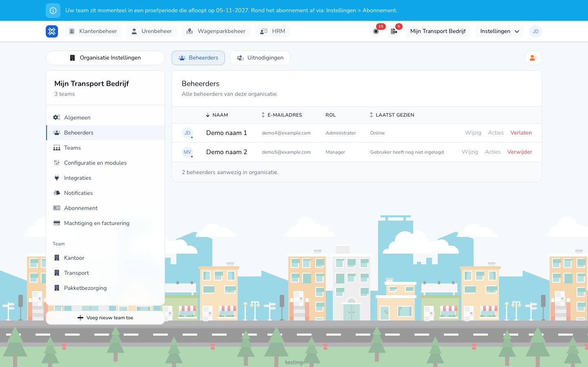

{/* translated-from: nl/settings/organization/administrators.mdx sha256:896eb6ae26f931a378b0cdf3ffa15127ae58ed53ed14ed87edfee89d7de02d59 */}

import { Hint } from '/snippets/hint.jsx';

## What this page is for

Here you manage who runs your organization: the administrators and managers. Workers who only register hours are managed under [Workers](/en/management/human-resources/workers/overview).

## Screenshot

## Who can use this

- An administrator of the organization.

## How to use this page

Invite someone:

1. Open **Settings** → **Organization settings** → **Administrators**.
2. At the top right, click the button with the person-plus icon.
3. Fill in the **Email**, choose the **Role** and, if you have more teams, the **Teams**.
4. Click **Invite**.

Change or delete someone:

1. On the **Administrators** tab, click **Edit** in the person's row.
2. On **Details**, change the **Full name**, or on **Permissions** the **Role** and the **Teams**, and click **Save**.
3. Click **Delete** to remove someone from the organization, and confirm.

## Fields

| Column | Meaning |
|-------|-----------|
| **Name** | The administrator's or manager's name. |
| **Email Address** | The email address the person logs in with. |
| **Role** | **Administrator** or **Manager**. |
| **Last seen** | **Online**, how long ago the person was active, or **User has not logged in yet**. |

For an invitation:

| Field | What you fill in |
|------|--------------|
| **Email** (required) | The address the invitation goes to. |
| **Role** (required) | **Administrator** or **Manager**. |
| **Teams** | The teams the person can access. At least one. You see this field if your organization has more than one team. |

What a role may do:

| Role | What this role may do |
|-----|------------------|
| **Administrator** | Manage the whole organization: all settings, administrators, subscription and invoices, and everything a manager may do. |
| **Manager** | View, approve, reject, create and export time registrations, for the teams the manager belongs to. |

A worker does not get a role here. A worker does their own time registrations and gets an account if you create the worker with an account. See [Create worker](/en/management/human-resources/workers/create).

## What happens next

- The invitation is on the **Invitations** tab until it is accepted. There you can **Resend** or **Cancel** it.
- After accepting, the person is on the **Administrators** tab.
- With **Leave** in your own row, you leave the organization yourself.
- The permissions follow directly from the role. You do not turn individual permissions on or off per person.
- With **Teams**, you limit a manager to certain teams. If you choose all teams, the role applies to the whole organization.

## Limitations

- An organization always keeps at least one administrator. <Hint kind="red">You cannot delete the last administrator.</Hint>
- You cannot change your own role and teams yourself.
- A manager does not see the **Organization settings** menu.
- You cannot invite an email address that already has an invitation or already belongs to the organization.
