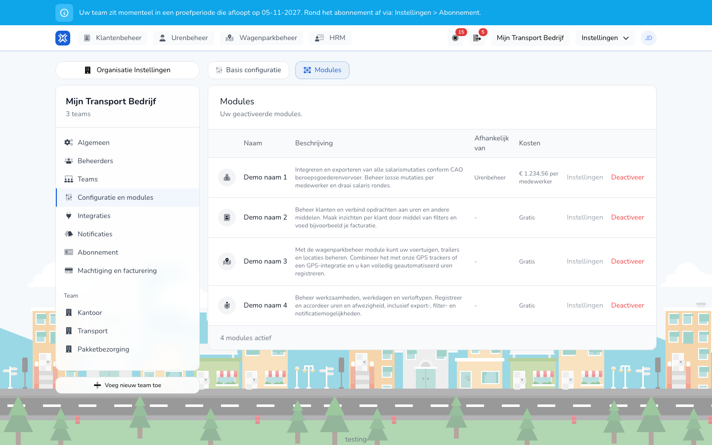

{/* translated-from: nl/settings/organization/configuration/modules.mdx sha256:af7a2d1880b349c542157d08ed9ebdc8470d02ab150f2462a43779e735b39329 */}

import { Hint } from '/snippets/hint.jsx';

## What this page is for

Here you turn modules on or off for your organization, and set per module how it works.

## Screenshot

## Who can use this

- An administrator of the organization.

## How to use this page

1. Open **Settings** → **Organization settings** → **Configuration and modules** and choose the **Modules** tab.
2. Click **Add module** and choose **Activate** next to a module, or click **Deactivate** next to an active module.
3. In the window, choose whether the change takes effect immediately or from the next subscription period.
4. Next to a module, click **Settings** to change that module's settings, and click **Save**.

## Fields

The modules:

| Module | What it does |
|--------|--------------|
| **Hour management** | Manage activities, workdays and leave types, and register and approve hours and absence. |
| **Client management** | Manage clients and link them to hours. |
| **Fleet management** | Manage vehicles, trailers and locations, with trackers or a GPS integration. |
| **Payroll inputs** | Run payroll runs and export payroll inputs. Works together with **Hour management**. |

In the **Cost (per worker per month)** column you see per module whether it is **Free** or what it costs per worker. <Hint kind="yellow">Which modules you can turn on depends on your subscription.</Hint>

Settings per module, under **Settings**:

| Module | Settings |
|--------|--------------|
| **Hour management** | Whether workers create time registrations themselves, whether approval is skipped, manual and draft time registrations, and the time step size. |
| **Client management** | Whether you can create a client while registering. |
| **Payroll inputs** | The payroll processing period, the start day, the format of the payroll export and the period of the variable pay components. <Hint kind="yellow">This depends on the CAO or the contract setting: agree on these settings with your payroll administration.</Hint> |

## What happens next

- An activated module appears in the menu. During the trial period, you use a module for free.
- If you turn a module off from the next period, you see "This module will no longer be available from …" until then. With **Stop deactivation** or **Stop activation**, you undo a scheduled change.

## Limitations

- A module that needs another module is shown with that module in the **Uses** column.
