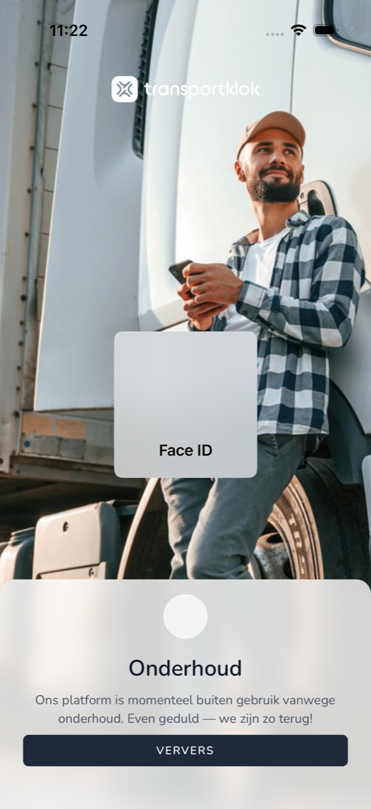

{/* translated-from: nl/workforce/app/malfunctions.mdx sha256:72b0b3d392a21fbb366c8166067b48cd4bad780ed95510d94e3dc413d8e5e742 */}

import { Hint } from '/snippets/hint.jsx';

## What this page is for

Sometimes the app cannot continue. Then you see a screen that says why. Here you read what each screen means and what you do.

## Screenshot

## Who can use this

- Every worker who uses the app.

## How to use this page

1. Read the screen's title.
2. Look up that title in the table below and do what it says.

## Fields

| Screen | What it means | What you do |
|--------|------------------|------------|
| **You're offline** | Your phone has no internet. | Turn on wifi or mobile data and tap **Refresh**. |
| **Maintenance** | TransportKlok is briefly out of use for maintenance. | Wait a moment and tap **Refresh**. |
| **Service unreachable** | The app cannot connect to TransportKlok. | Try again shortly with **Refresh**. |
| **Update required** | This version of the app no longer works. | Update the app in the App Store or Google Play. |
| **Updating TransportKlok** | The app is downloading and installing a new version. | Leave the app open until this is finished. |
| `Sessie niet hersteld` | The app could not sign you in again automatically. | Tap `Opnieuw inloggen`. |

## What happens next

- When it works again, the app continues where you were.

## Limitations

- As long as you see one of these screens, you cannot register anything. <Hint kind="yellow">If **Maintenance** or **Service unreachable** lasts long, note your hours and register them later.</Hint>
