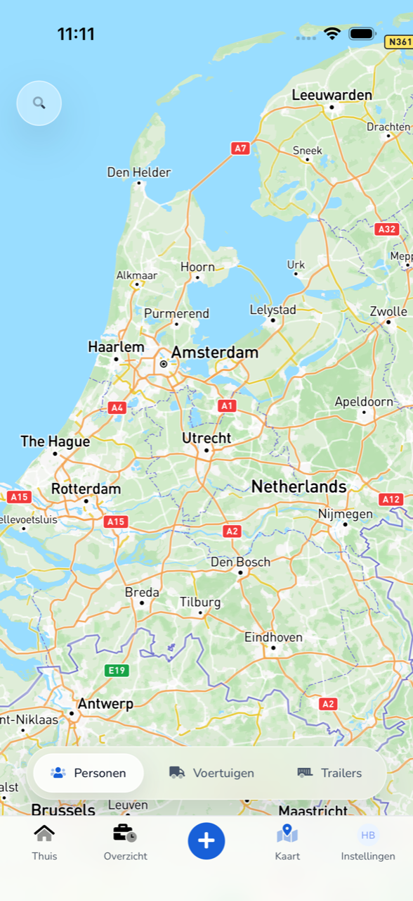
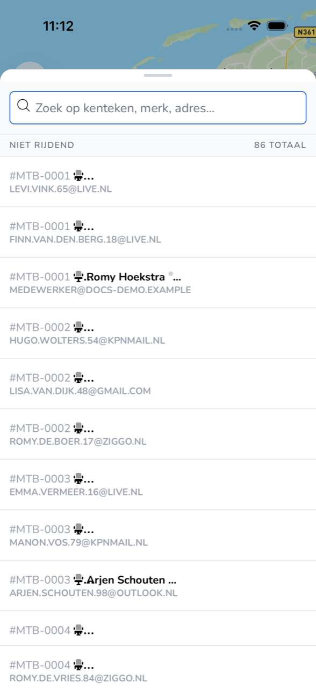

{/* translated-from: nl/workforce/app/map.mdx sha256:3f984df70bf62f5a16c8250c5b3445e9b38c215f49e71bed769a63e657b90a77 */}

## What this page is for

On **Map** you see where your organization's colleagues, vehicles and trailers are.

## Screenshot

## Who can use this

- Every worker who uses the app.

## How to use this page

1. At the bottom, tap **Map**.
2. At the bottom, choose **People**, **Vehicles** or **Trailers**.
3. At the top left, tap the magnifying glass to open the list.
4. Search by license plate, make or address.

## Fields

| Item | What you see |
|-----------|------------|
| **People** | Colleagues with their vehicle. |
| **Vehicles** | Your organization's vehicles. |
| **Trailers** | Your organization's trailers. |
| Group, such as **Not moving** | Whether someone or something is moving. On the right is the total. |

## What happens next

- With **People**, **Vehicles** or **Trailers**, you switch what the map and the list show.

## Limitations

- On the map you only look. Your employer changes vehicles and trailers in TransportKlok.
