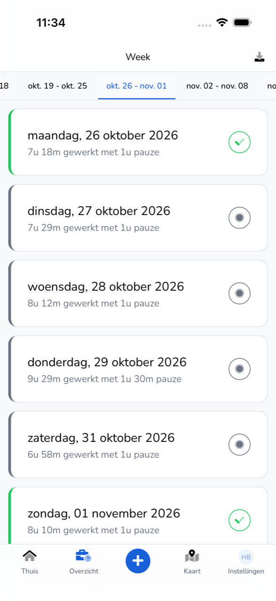
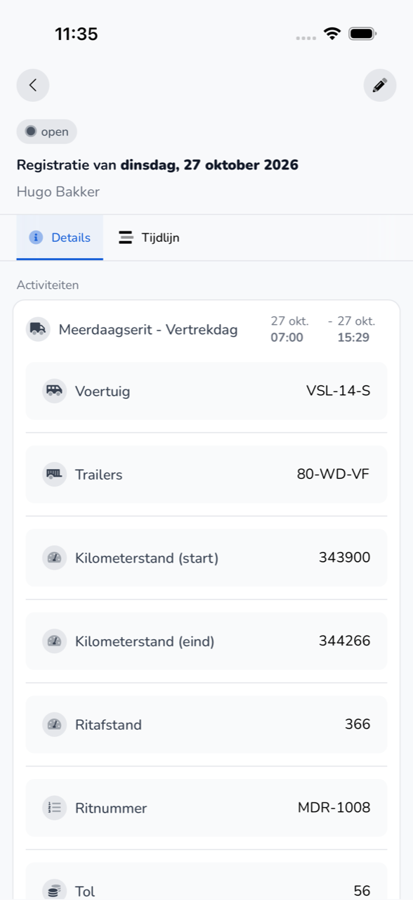

{/* translated-from: nl/workforce/app/overview.mdx sha256:cd32ebb743bdf09617ea72c35984c933fa3010a16f59fc7d0ac65fcc2799f798 */}

import { Hint } from '/snippets/hint.jsx';

## What this page is for

In **Overview** you see your registrations per week. Here you open a registration and change one that is still open.

## Screenshot

## Who can use this

- Every worker who uses the app, for their own registrations.

## How to use this page

View a registration:

1. At the bottom, tap **Overview**.
2. At the top, choose the week.
3. Tap a day. You see the registration with the **Details** and **Timeline** tabs.

Change a registration:

1. Open a registration that is still open.
2. At the top right, tap the pencil.
3. Change the details and tap **Complete**.

## Fields

| Item | What you see |
|-----------|------------|
| Day | The date, how much you worked and how much break you had. |
| Green check mark | The registration has been approved. |
| Grey dot | The registration is open and waiting for approval. |
| **Total** | Your hours worked, break and absence in that week. |
| **Details** | The activities with times, vehicle and trip details, and your break. |
| **Timeline** | Who created, changed or approved the registration, and when. |

## What happens next

- After a change, you see "Time entry updated".
- An approved registration gets a green check mark.

## Limitations

- You can only change a registration that is open. <Hint kind="yellow">If a registration has already been approved and something is wrong, ask your employer to change it.</Hint>
