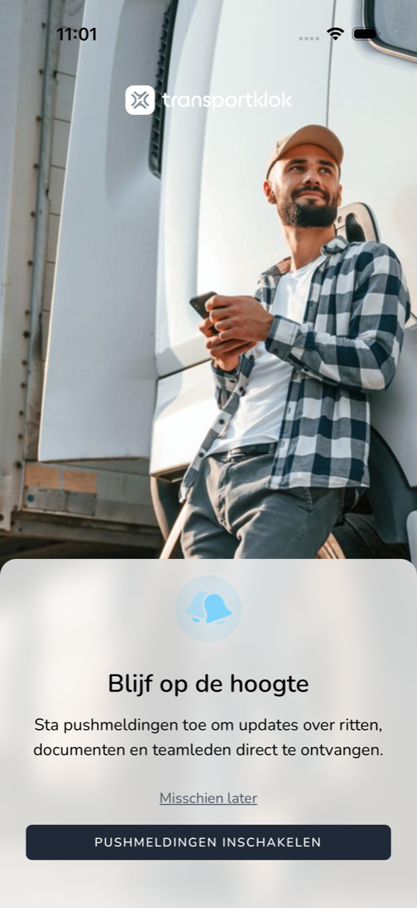

{/* translated-from: nl/workforce/app/push-notifications.mdx sha256:411d08cec7befaf6239f0ed999992cd57991126ebce8493c60b121f6830f2786 */}

## What this page is for

With push notifications, you receive TransportKlok messages on your phone, even when the app is closed. Here you read how to turn them on.

## Screenshot

## Who can use this

- Every worker who uses the app.

## How to use this page

1. After you log in for the first time, you see **Stay informed**.
2. Tap **Enable push notifications**.
3. Your phone asks whether TransportKlok may send notifications. Tap `Sta toe` (on Android: **Authorize**).

If you want to decide this later, tap **Maybe later**.

## Fields

| Button | What happens |
|------|----------------|
| **Enable push notifications** | Your phone asks for permission for notifications. |
| **Maybe later** | You continue without notifications. The app asks again later. |

## What happens next

- With permission, you receive TransportKlok notifications on your phone.
- If you chose **Maybe later**, the app asks again after a while with `Push notificaties`.

## Limitations

- If you refused notifications in your phone's prompt, you can only turn them on again in your phone's settings, under TransportKlok. The app then shows `Push notificaties uitgeschakeld` as a reminder.
