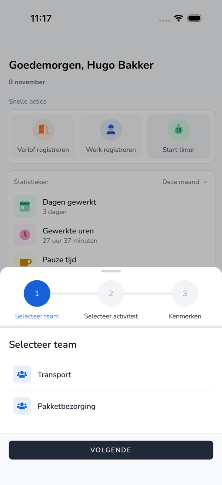

{/* translated-from: nl/workforce/app/timer.mdx sha256:bbcf1e5cd80cfec63ecccdececf01bce9eb074203a25f6146cafda5417818840 */}

import { Hint } from '/snippets/hint.jsx';

## What this page is for

With the timer, you keep track of your work while you are doing it. You start the timer at the beginning and stop it when you are done.

## Screenshot

## Who can use this

- Workers of an organization that takes part in the beta program. <Hint kind="grey">If your organization does not take part, you do not see **Start timer**.</Hint>

## How to use this page

1. On **Home**, tap **Start timer**.
2. Under **Select team**, choose your team and tap **Next**.
3. Under **Select activity**, choose what you are going to do and tap **Next**.
4. Under **Attributes**, optionally fill in a **Memo** and tap **Start**.

## Fields

| Button | What happens |
|------|----------------|
| **Stop** | The timer stops and the time becomes a registration. |
| **Switch** | You stop the current activity and start another. |
| **Edit details** | You change the details of the running activity. |
| **Delete** | You delete the running registration. |

## What happens next

- On **Home** is the **Active recording** with the time running.
- After **Stop**, the registration is in [Overview](/en/workforce/app/overview).

## Limitations

- If the timer was started outside the app, you cannot change or stop it in the app.
- If today's pay period has already been processed, the timer does not start.
