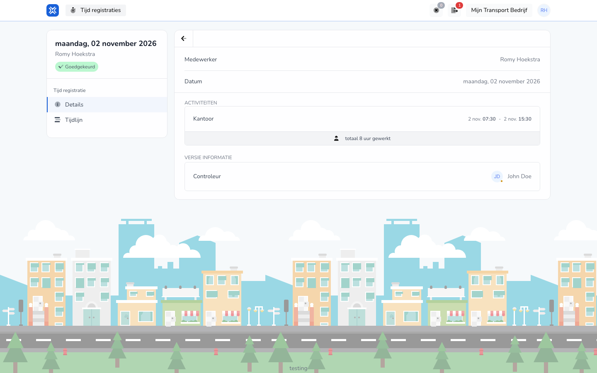

{/* translated-from: nl/workforce/hour-management/time-registrations/details.mdx sha256:7e34bd81d4100dc1226c633b2f917bc9bee9e93f97557dd87703f1f2d76384e8 */}

## What this page is for

On this page you view the content of one existing registration.

## What you can do here

- Read through a registration.
- Check that the entered details are correct.

## Screenshot

## What you see on the page

- The details of one registration.
- The filled-in details of that registration.

## How to use this page

1. Open an existing registration from your overview.
2. Read through the details calmly.
3. Only continue to editing if something needs to be changed.

## What happens next

- You know whether your registration is correct or still needs to be changed.

## Good to know

- Mainly use this page for checking.
- Only change something when you are sure what is wrong or has changed.

## Related pages

- Time registration overview
- Edit time registration
- Time registration timeline

