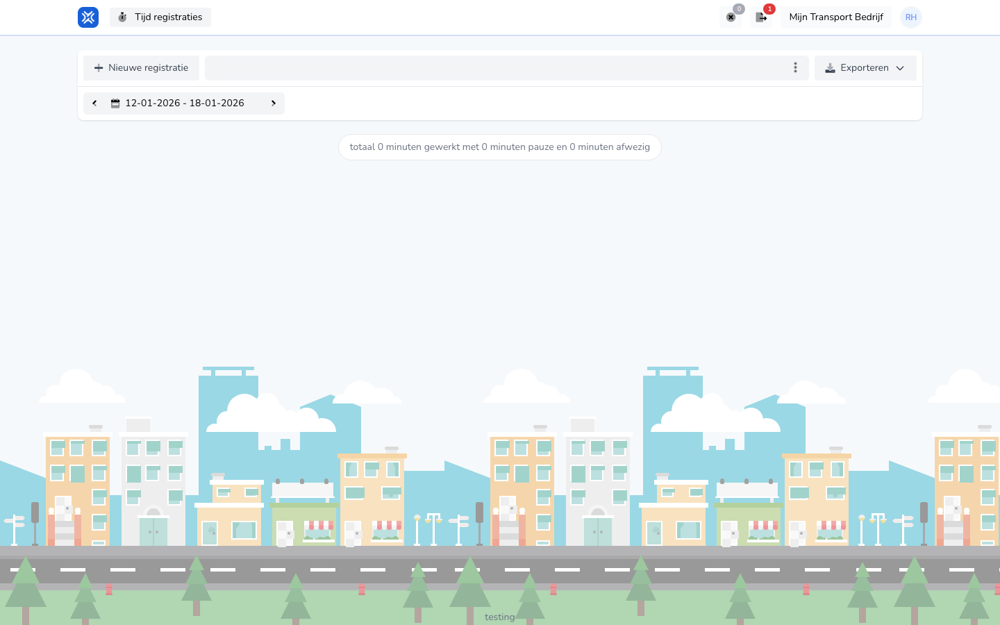

{/* translated-from: nl/workforce/hour-management/time-registrations/overview.mdx sha256:b3e5f1201fa9aeae533b47bfa3c8fae5be8a988fb9de9791bd6b19240aa0f4e0 */}

## What this page is for

Here you see your own time registrations and start a new registration.

## What you can do here

- View your registrations.
- Create a new registration.
- See your total minutes worked.

## Screenshot

## What you see on the page

- The **New registration** button.
- A period choice.
- A summary of minutes worked and absent.

## How to use this page

1. Open your time registration overview.
2. First check that the right period is selected.
3. Use **New registration** if you want to add something.

## What happens next

- You see your current total for the chosen period right away.
- New registrations then appear in this overview.

## Good to know

- This screen is meant for your own work registration.
- Always check that you are looking at the right week.

## Related pages

- Create time registration
- Time registration details

