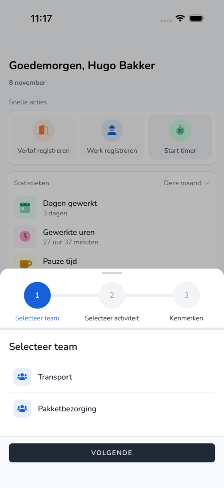

import { Hint } from '/snippets/hint.jsx';

## Waar deze pagina voor is

Met de timer houdt u uw werk bij terwijl u bezig bent. U start de timer bij het begin en stopt hem als u klaar bent.

## Schermafbeelding

## Wie dit mag gebruiken

- Medewerkers van een organisatie die meedoet aan het bètaprogramma. <Hint kind="grey">Doet uw organisatie niet mee, dan ziet u **Start timer** niet.</Hint>

## Zo gebruikt u deze pagina

1. Tik op **Thuis** op **Start timer**.
2. Kies bij **Selecteer team** uw team en tik op **Volgende**.
3. Kies bij **Selecteer activiteit** wat u gaat doen en tik op **Volgende**.
4. Vul bij **Kenmerken** eventueel een **Memo** in en tik op **Starten**.

## Velden

| Knop | Wat er gebeurt |
|------|----------------|
| **Stop** | De timer stopt en de tijd wordt een registratie. |
| **Wissel** | U stopt de huidige activiteit en start een andere. |
| **Kenmerken aanpassen** | U past de gegevens van de lopende activiteit aan. |
| **Verwijderen** | U verwijdert de lopende registratie. |

## Wat er daarna gebeurt

- Op **Thuis** staat de **Lopende werkzaamheid** met de tijd die loopt.
- Na **Stop** staat de registratie in [Overzicht](/medewerkers/app/overzicht).

## Beperkingen

- Is de timer buiten de app gestart, dan kunt u hem in de app niet wijzigen of stoppen.
- Is de salarisperiode van vandaag al verwerkt, dan start de timer niet.
