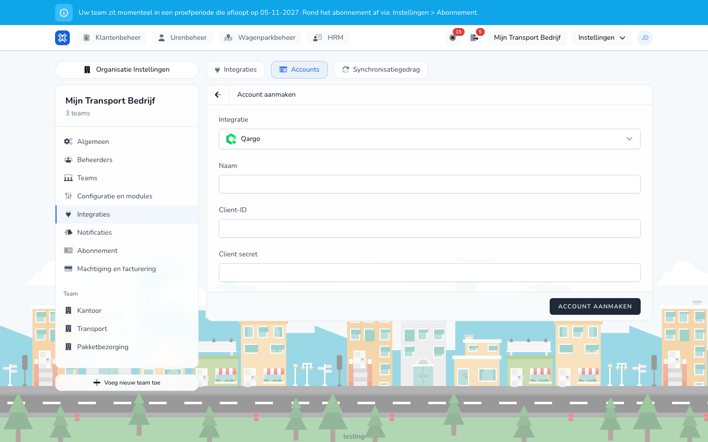

import { Hint } from '/snippets/hint.jsx';

## Waar deze pagina voor is

Met de Qargo-koppeling neemt TransportKlok uw klanten uit Qargo over als opdrachtgevers, met hun factuuradres als locatie.

## Schermafbeelding

## Wie dit mag gebruiken

- Een beheerder of manager van de organisatie.
- De organisatie heeft de module **Klantenbeheer** nodig.

## Zo gebruikt u deze pagina

1. Open **Instellingen** → **Organisatie Instellingen** → **Integraties** en kies het tabblad **Accounts**.
2. Klik op **Account aanmaken** en kies bij **Integratie** voor **Qargo**.
3. Vul een **Naam**, de **Client-ID** en het **Client secret** van uw Qargo API-gebruiker in en klik op **Account aanmaken**.
4. Open het tabblad **Integraties**, klik op **Integratie toevoegen** en klik bij **Qargo** op **Verbinden**.
5. Kies het **Account**, geef de koppeling een **Naam** en klik op **Verbinden**.

## Velden

| Veld | Wat u invult |
|------|--------------|
| **Naam** (verplicht) | De naam van het account in het overzicht. |
| **Client-ID** (verplicht) | De Client-ID van uw Qargo API-gebruiker. |
| **Client secret** (verplicht) | Het geheim dat bij die Client-ID hoort. |

<Hint kind="yellow">De API-gebruiker in Qargo heeft de rol `API_MASTER_DATA` of `API_ACCOUNTING` nodig om bedrijven te mogen lezen. Zonder die rol weigert TransportKlok het account.</Hint>

## Wat er daarna gebeurt

| Functie | Loopt vanzelf |
|---------|---------------|
| **Klanten synchroniseren** | elke dag om 03:00 |

- Met **Synchroniseren** op het tabblad **Synchronisatiegedrag** haalt u de klanten meteen op. Zie [Synchronisatiegedrag](/nl/settings/organization/integrations/capabilities).
- Elke klant in Qargo wordt een opdrachtgever in TransportKlok, met de naam als **Naam**, de klantcode als **Referentie** en de notitie als **Notities**. Zie [Opdrachtgevers](/nl/management/customer-management/customers/overview).
- Het factuuradres van de klant wordt een locatie van het type **Klant** bij die opdrachtgever.
- De eerste keer haalt de koppeling alle klanten op. Daarna alleen de klanten die in Qargo zijn gewijzigd.

## Beperkingen

- De koppeling haalt alleen gegevens op uit Qargo. Ze stuurt niets terug.
- Bedrijven in Qargo die geen klant zijn of gearchiveerd zijn, neemt de koppeling niet over.
- Past u in TransportKlok de naam, referentie of notities van een overgenomen opdrachtgever aan, dan blijft uw wijziging staan. <Hint kind="grey">Een veld dat u niet hebt aangepast, volgt Qargo bij de volgende synchronisatie.</Hint>
- Heeft het factuuradres in Qargo geen coördinaten, dan komt de opdrachtgever wel over, maar zonder locatie.
- Een opdrachtgever of locatie die u in TransportKlok verwijdert, komt niet terug. <Hint kind="red">De koppeling maakt een verwijderde opdrachtgever niet opnieuw aan.</Hint>
- De koppeling is in bèta. U ziet Qargo alleen als uw organisatie meedoet aan het bètaprogramma.
