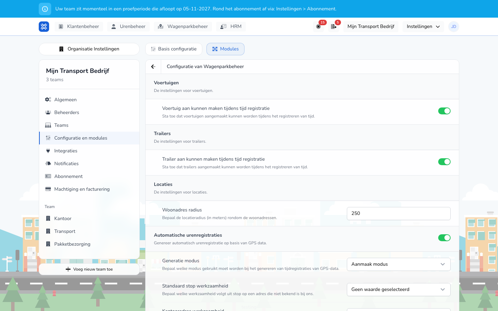

import { Hint } from '/snippets/hint.jsx';

## Waar deze pagina voor is

Met automatische urenregistratie maakt TransportKlok tijdregistraties uit de ritten en stops die uw GPS-koppeling of trackers doorgeven. Uw medewerkers hoeven die uren dan niet zelf in te voeren.

## Schermafbeelding

## Wie dit mag gebruiken

- Een beheerder van de organisatie zet het aan.
- De organisatie heeft de modules **Wagenparkbeheer** en **Urenbeheer** nodig, en voertuigen met een tracker of een GPS-koppeling. Zie [Telematica](/nl/management/fleet-management/telematics/overview).

## Zo gebruikt u deze pagina

1. Open **Instellingen** → **Organisatie Instellingen** → **Configuratie en modules** en kies het tabblad **Modules**.
2. Klik bij **Wagenparkbeheer** op **Instellingen**.
3. Zet **Automatische urenregistraties** aan.
4. Kies de **Generatie modus** en de werkzaamheden per soort adres.
5. Klik op **Opslaan**.

## Velden

| Veld | Wat u kiest |
|------|-------------|
| **Generatie modus** | **Aanmaak modus**: TransportKlok maakt nieuwe tijdregistraties uit de GPS-gegevens. **Vervang modus**: TransportKlok maakt geen nieuwe registraties, maar vult in bestaande registraties de werkzaamheid **Automatisch (GPS segment)** aan met de ritten en stops. Standaard staat **Aanmaak modus** aan. |
| **Standaard stop werkzaamheid** | De werkzaamheid voor een stop op een adres dat TransportKlok niet kent. Standaard leeg: zo'n stop krijgt dan geen werkzaamheid. |
| **Kantooradres werkzaamheid** | De werkzaamheid voor een stop op een kantooradres. Standaard **Standplaats**. |
| **Woonadres werkzaamheid** | De werkzaamheid voor een stop op een woonadres. Standaard **Standplaats**. |
| **Klantadres werkzaamheid** | De werkzaamheid voor een stop op een klantadres. Standaard **Laden & Lossen (extern)**. |
| **Stoplengte (minuten)** | Hoe lang een stop moet duren om de rit ervoor af te sluiten. Standaard 240 minuten. |
| **Minimale activiteitsduur (seconden)** | Hoe lang een activiteit moet duren om een regel in de registratie te worden. Standaard 60 seconden. |
| **Automatische registraties starten op** | De datum vanaf wanneer TransportKlok registraties maakt. Leeg: zonder vaste startdatum. |
| **Geen vaste startdatum** | Aan: de medewerker heeft geen vaste startdatum, wat de datum van de organisatie ook is. |
| **Onbetaald woon-werkverkeer** | Aan: ritten tussen thuis en kantoor worden geboekt op de onbetaalde woon-werkactiviteit. |

Welk soort adres een stop is, volgt uit uw [locaties](/nl/management/fleet-management/locations/overview).

## Wat er daarna gebeurt

- Uit de ritten en stops van een medewerker maakt TransportKlok een tijdregistratie, met de ritten en stops als werkzaamheden.
- De registraties staan bij [Tijdregistratie](/nl/management/hour-management/time-registrations/overview) en in de app van de medewerker, zoals elke andere registratie. U keurt ze op dezelfde manier goed.
- Een registratie die is goedgekeurd, die iemand heeft aangepast of die in een verwerkte salarisperiode valt, past TransportKlok niet meer aan.

TransportKlok werkt met twee versies van automatische urenregistratie. <Hint kind="grey">Welke versie uw organisatie gebruikt, stelt TransportKlok voor u in. De instellingen hierboven zijn voor beide versies gelijk.</Hint>

| Versie | Hoe het werkt |
|--------|---------------|
| **Versie 1** | TransportKlok maakt de registraties in één keer uit de ritten en stops. Overlapt een rit met een bestaande registratie, dan slaat het die rit over. |
| **Versie 2** | TransportKlok werkt de registraties bij zodra er nieuwe GPS-gegevens binnenkomen, en laat goedgekeurde of aangepaste registraties met rust. |

## Beperkingen

- Automatische urenregistratie werkt voor een organisatie met precies één team. Heeft uw organisatie meer teams, dan ziet u bij het aanzetten "Automatische urenregistratie vraagt een organisatie met precies één team".
- Een medewerker moet in TransportKlok aan het voertuig en aan de GPS-gegevens gekoppeld zijn. Zonder die koppeling komen er geen registraties.
- Past een registratie niet, bijvoorbeeld omdat die overlapt met een bestaande registratie of buiten het contract valt, dan maakt TransportKlok die registratie niet. <Hint kind="yellow">Controleer dan de registraties van die dag zelf bij Tijdregistratie.</Hint>
