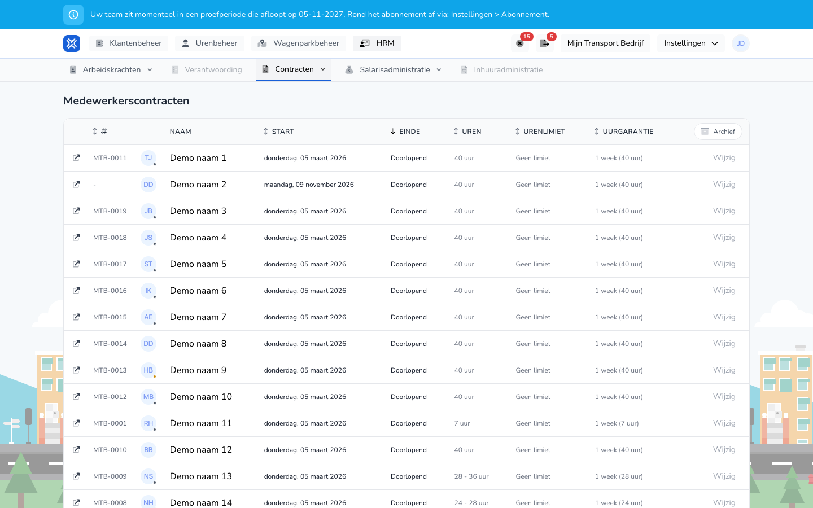

import { Hint } from '/snippets/hint.jsx';

## Waar deze pagina voor is

Op **Contracten** ziet u de contracten van al uw arbeidskrachten bij elkaar, per soort dienstverband: medewerkers in loondienst, zzp'ers en charters.

## Schermafbeelding

## Wie dit mag gebruiken

- Een beheerder van de organisatie.

## Zo gebruikt u deze pagina

1. Open **HRM** en kies **Contracten**.
2. Kies in het menu onder **Contracten** de lijst: **Medewerkerscontracten**, **ZZP-contracten** of **Chartercontracten**.
3. Klik op **Archief** om de contracten te zien die al zijn afgelopen.
4. Klik op **Wijzig** bij een contract om het contract van die arbeidskracht aan te passen. Zie [Arbeidskracht wijzigen](/nl/management/human-resources/workers/edit).

## Velden

| Kolom | Betekenis |
|-------|-----------|
| **Naam** | De arbeidskracht, met personeelsnummer en e-mailadres. Klik op de naam om de arbeidskracht te openen. |
| **Start** | De datum waarop het contract begint. |
| **Einde** | De datum waarop het contract eindigt, of **Doorlopend**. |
| **Uren** | Alleen bij medewerkerscontracten: de contracturen. |
| **Urenlimiet** | Alleen bij medewerkerscontracten: het maximum aantal uren, of **Geen limiet**. |
| **Uurgarantie** | Alleen bij medewerkerscontracten: hoeveel weken loon gegarandeerd is, met het aantal uren. |

## Wat er daarna gebeurt

- Na **Wijzig** komt u op het tabblad **Contracten** van de arbeidskracht. Daar maakt u een contract aan, past u het aan of zet u een einddatum.

## Beperkingen

- Op deze pagina maakt of beëindigt u geen contract. Dat doet u bij de arbeidskracht zelf. Zie [Arbeidskracht aanmaken](/nl/management/human-resources/workers/create).
- Zonder **Archief** ziet u alleen contracten die nog lopen of vandaag of later eindigen.
- U ziet alleen arbeidskrachten met een actieve licentie. <Hint kind="grey">De kolommen **Uren**, **Urenlimiet** en **Uurgarantie** ziet u als uw organisatie de module voor salarisverwerking gebruikt.</Hint>
