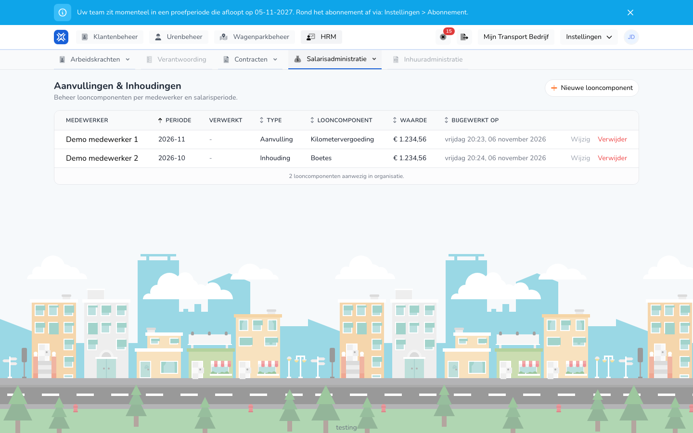

import { Hint } from '/snippets/hint.jsx';

## Waar deze pagina voor is

Hier beheert u bedragen die u los van de uren aan het salaris toevoegt of ervan afhaalt, zoals een kilometervergoeding, een voorschot of een boete. Zo'n bedrag heet een looncomponent.

## Schermafbeelding

## Wie dit mag gebruiken

- Een beheerder met volledige rechten in de organisatie.
- De organisatie heeft de module **Salarismutaties** nodig.

## Zo gebruikt u deze pagina

1. Open **HRM** en kies **Salarisadministratie**.
2. Klik op **Aanvullingen & Inhoudingen**.
3. Bekijk per regel de medewerker, de periode en het bedrag.
4. Klik op **Nieuwe looncomponent** om een bedrag toe te voegen. Zie [Looncomponent aanmaken](/nl/management/human-resources/payroll-components/create).
5. Klik op **Wijzig** of **Verwijder** in de rij van een looncomponent. Zie [Looncomponent wijzigen](/nl/management/human-resources/payroll-components/edit).

## Velden

| Kolom | Betekenis |
|-------|-----------|
| **Medewerker** | De medewerker die het bedrag krijgt of inlevert. |
| **Periode** | De salarisperiode, bijvoorbeeld 2026-10. |
| **Verwerkt** | De status van de salarisronde die het bedrag heeft uitbetaald. Een streepje betekent dat dat nog niet is gebeurd. |
| **Type** | **Aanvulling** of **Inhouding**. |
| **Looncomponent** | Het soort bedrag, zoals **Kilometervergoeding** of **Boetes**. |
| **Waarde** | Het bedrag. |
| **Bijgewerkt op** | Wanneer de looncomponent voor het laatst is opgeslagen. |

## Wat er daarna gebeurt

- Een looncomponent telt mee in de salarisronde van zijn periode. Is die ronde een concept of vergrendeld, dan wordt hij meteen opnieuw berekend. <Hint kind="grey">U hoeft de ronde daarvoor niet zelf opnieuw uit te voeren.</Hint>
- Is die ronde al verwerkt, dan krijgt hij de status **Gecorrigeerd**. Het bedrag gaat dan mee met een correctie. Zie [Correcties op een salarisronde](/nl/management/human-resources/payroll-runs/corrections).

## Beperkingen

- Het overzicht heeft geen filters en geen zoekveld.
- **Verwijder** vraagt om bevestiging en haalt de looncomponent daarna direct weg. <Hint kind="red">Een verwijderde looncomponent kunt u niet terughalen. Hoort het bij een verwerkte ronde, dan wordt de ronde opnieuw gecontroleerd op correcties.</Hint>
