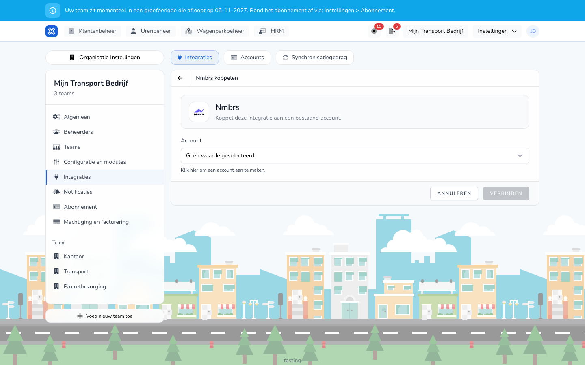

import { Hint } from '/snippets/hint.jsx';

## Waar deze pagina voor is

Met de Nmbrs-koppeling stuurt u verwerkte salarisrondes naar Nmbrs en haalt u medewerkers, contracten en verlof uit Nmbrs op.

## Schermafbeelding

## Wie dit mag gebruiken

- Een beheerder of manager van de organisatie, met een Nmbrs-account dat toegang heeft tot de werkgever.
- De organisatie heeft de module **Salarismutaties** nodig.

## Zo gebruikt u deze pagina

1. Maak een account aan voor **Nmbrs** en log in bij Nmbrs. Zie [Accounts](/nl/settings/organization/integrations/accounts).
2. Open **Integraties**, klik op **Integratie toevoegen** en klik bij **Nmbrs** op **Verbinden**.
3. Kies het **Account**.
4. Kies de **Werkgever** uit de lijst van Nmbrs.
5. Geef de koppeling een **Naam** en klik op **Verbinden**.
6. Vul de instellingen in en klik op **Instellingen opslaan**.
7. Zet op **Synchronisatiegedrag** de schakelaar bij **Salarisrondes versturen** aan en sla op.

## Velden

| Veld | Wat u invult |
|------|--------------|
| **Werkgever** (verplicht) | Het bedrijf in Nmbrs. Een werkgever die al gekoppeld is, kunt u niet nog eens kiezen. |
| **Maak automatisch medewerkers aan** | Staat dit uit, dan koppelt TransportKlok alleen medewerkers met hetzelfde personeelsnummer en dezelfde achternaam. |
| **Salariscodekoppelingen** | Welke Nmbrs-looncode bij welk soort uren en welke vergoeding hoort. <Hint kind="yellow">Dit hangt af van de inrichting van uw Nmbrs-bedrijf. Stem de codes af met wie uw salarisadministratie doet.</Hint> |
| **Nmbrs-medewerkers voor salarisimport** | De Nmbrs-medewerkers die meedoen, gescheiden door komma's of regels. Laat u dit leeg, dan doen alle gekoppelde medewerkers mee. |
| **Nmbrs verlofgroepkoppelingen** | Welke verlofgroep in Nmbrs bij welk soort verlof hoort. |

## Wat er daarna gebeurt

- Bij **Versturen** van een salarisronde zet TransportKlok per medewerker de uren en looncomponenten van die periode in Nmbrs, en voegt het loonoverzicht als pdf toe. Meegenomen correcties gaan mee.
- Gegevens die TransportKlok eerder voor die periode in Nmbrs zette, worden bijgewerkt of verwijderd, zodat Nmbrs de laatste verwerkte versie heeft.
- Elke nacht haalt TransportKlok medewerkers, contracten en verlof uit Nmbrs op.
- Op **Synchronisatiegedrag** → **Uitvoeringen** ziet u per verzending of die is **Geslaagd** of **Mislukt**.

## Beperkingen

- Het Nmbrs-bedrijf moet met maandperiodes werken. <Hint kind="yellow">Dit hangt af van de inrichting van uw Nmbrs-bedrijf.</Hint>
- Medewerkers die niet aan de gekozen werkgever in Nmbrs zijn gekoppeld, slaat de verzending over.
- Een verzending mislukt onder meer als de toegang tot Nmbrs is verlopen, als er geen werkgever is gekozen, als een looncomponent geen Nmbrs-code heeft, of als die periode in Nmbrs al gegevens bevat van een andere ronde of koppeling.
