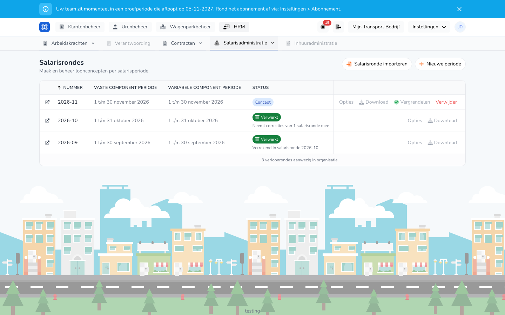

## Waar deze pagina voor is

Hier ziet u alle salarisrondes van uw organisatie, met per ronde de loonperiode en de status. Vanuit dit overzicht maakt u een nieuwe ronde aan, verwerkt u een ronde en downloadt u de exports.

## Schermafbeelding

## Wie dit mag gebruiken

- Een beheerder met volledige rechten in de organisatie.
- De organisatie heeft de module **Salarismutaties** nodig. Zonder die module staat **Salarisrondes** niet in het menu.

## Zo gebruikt u deze pagina

1. Open **HRM** en kies **Salarisadministratie**.
2. Klik op **Salarisrondes**.
3. Zoek de ronde in het overzicht. De nieuwste ronde staat bovenaan.
4. Gebruik de knoppen in de rij van de ronde. **Opties** en **Download** openen een keuzelijst.
5. Klik op het pictogram vóór het nummer om de details van de ronde te openen.
6. Klik op **Nieuwe periode** om een ronde aan te maken. Zie [Salarisronde aanmaken](/nl/management/human-resources/payroll-runs/create).

## Velden

Het overzicht heeft geen filters. Elke rij toont:

| Kolom | Betekenis |
|-------|-----------|
| **Nummer** | Het nummer van de ronde, bijvoorbeeld 2026-10. |
| **Vaste component periode** | De periode van de vaste salariscomponenten. |
| **Variabele component periode** | De periode van de variabele salariscomponenten. |
| **Status** | Waar de ronde staat, zie hieronder. |
| **Laatst uitgevoerd op** | Wanneer de ronde voor het laatst is berekend. |

Een ronde heeft een van deze statussen:

| Status | Betekenis |
|--------|-----------|
| **Concept** | De ronde is berekend en kan nog worden aangepast. |
| **Bezig** | Een taak loopt, zoals een berekening of een analyse. Het percentage loopt mee. |
| **Vergrendeld** | De ronde is vergrendeld en klaar om af te ronden. |
| **Verwerkt** | De ronde is verwerkt. |
| **Gecorrigeerd** | Na verwerking is een verschil gevonden. Zie [Correcties](/nl/management/human-resources/payroll-runs/corrections). |
| **Mislukt** | De taak is niet gelukt. |

Onder de status kan ook staan:

- `Neemt correcties van 1 salarisronde mee`: deze ronde heeft de correctie van een oudere ronde meegenomen.
- `Verrekend in salarisronde` met een nummer: de correctie van deze ronde is in die nieuwere ronde betaald. De tekst is een link naar die ronde.

De knoppen in een rij hangen af van de status:

| Knop | Wanneer |
|------|---------|
| **Opties** → **Opnieuw uitvoeren** | Bij een concept. |
| **Opties** → **Ontgrendel** | Bij een vergrendelde ronde. |
| **Opties** → **Analyseer op correcties** | Bij een verwerkte of gecorrigeerde ronde. |
| **Vergrendelen** | Bij een concept. |
| **Afronden** | Bij een vergrendelde of gecorrigeerde ronde. Zie [Salarisronde verwerken](/nl/management/human-resources/payroll-runs/process). |
| **Download** | Toont de exports die voor de ronde klaar zijn. Zie [Exports van een salarisronde](/nl/management/human-resources/payroll-runs/exports). |
| **Verwijder** | Bij een concept of een vergrendelde ronde. |

## Wat er daarna gebeurt

- Het overzicht ververst zichzelf terwijl een taak loopt.
- **Vergrendelen** vraagt eerst om bevestiging in het venster **Salarisronde vergrendelen**. Daarna wordt de ronde opnieuw berekend en krijgt zij de status **Vergrendeld**.
- **Verwijder** vraagt eerst om bevestiging in het venster **Verloonronde verwijderen**.

## Beperkingen

- Een vergrendelde ronde kunt u niet verwijderen. Ontgrendel de ronde eerst met **Opties** → **Ontgrendel**.
- Een verwerkte of gecorrigeerde ronde kunt u niet verwijderen.
- Zolang een taak van een ronde loopt, wacht u tot die klaar is voordat u een nieuwe actie op die ronde start.
- Met **Salarisronde importeren** zet u een eerder gemaakte salarismutatie-export (.xlsx) als resultaat in een ronde. De uren worden dan niet opnieuw berekend.
