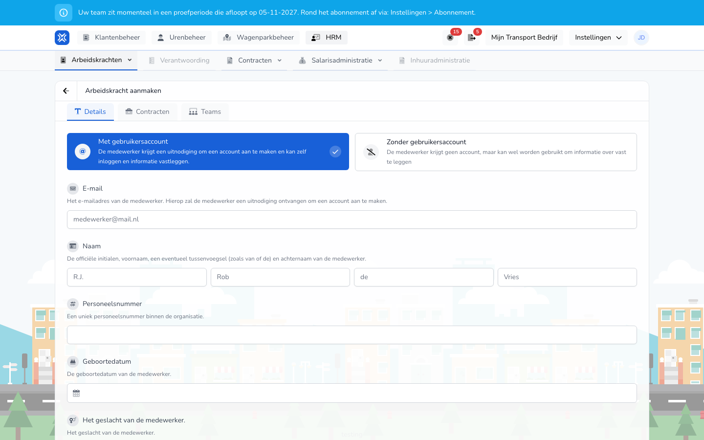

import { Hint } from '/snippets/hint.jsx';

## Waar deze pagina voor is

Hier voegt u een arbeidskracht toe: de persoon, het contract en de teams waar de arbeidskracht bij hoort.

## Schermafbeelding

## Wie dit mag gebruiken

- Een beheerder of manager van de organisatie.

## Zo gebruikt u deze pagina

1. Open **HRM** → **Arbeidskrachten** en klik op **Arbeidskracht aanmaken**.
2. Kies op het tabblad **Details** of de arbeidskracht een account krijgt: **Met gebruikersaccount** of **Zonder gebruikersaccount**.
3. Vul de gegevens van de persoon in.
4. Open het tabblad **Contracten**, klik op **+** en vul het contract in.
5. Open het tabblad **Teams** en vink de teams aan.
6. Klik op **Arbeidskracht aanmaken**.

## Velden

Tabblad **Details**:

| Veld | Wat u invult |
|------|--------------|
| **Met gebruikersaccount** / **Zonder gebruikersaccount** (verplicht) | Met een account kan de arbeidskracht zelf inloggen en gegevens vastleggen. Zonder account legt u alleen gegevens over de arbeidskracht vast. |
| **E-mail** | Alleen met een account, en dan verplicht. Hierop krijgt de arbeidskracht de uitnodiging. |
| **Naam** (verplicht) | Initialen, voornaam, eventueel tussenvoegsel en achternaam. Het tussenvoegsel is niet verplicht. |
| **Personeelsnummer** | Een uniek nummer binnen uw organisatie. |
| **Geboortedatum** | De geboortedatum. |
| Geslacht | **Man**, **Vrouw** of **Anders**. |
| **Tachograaf bestuurderscode** | De code van de bestuurderskaart van de chauffeur. <Hint kind="grey">Dit veld, **Woonadres** en **Locaties** ziet u als telematica aan staat voor uw organisatie.</Hint> |
| **Woonadres** | Het woonadres. |
| **Locaties** | Per soort locatie, zoals **Standplaatsen** en **Kantoren**, welke locaties voor deze arbeidskracht gelden. |

Tabblad **Contracten**, per contract:

| Veld | Wat u invult |
|------|--------------|
| **Dienstverband** (verplicht) | **Medewerker**, **ZZP'er** of **Charter**. |
| **Start** (verplicht) | De datum waarop het contract begint. |
| **Eind** | De datum waarop het contract eindigt. Leeg betekent doorlopend. |
| **Contracttype** | Bij een medewerker: **Oproepkracht**, **Deeltijdwerknemer** of **Voltijdwerknemer**. |
| **Contracturen type** | **Vaste uren** of **Min-max uren**. |
| **Contract uren** | Het aantal uur per week. <Hint kind="yellow">Een voltijdwerknemer heeft altijd 40 uur, een oproepkracht 0. Wat de uren voor de salarisberekening betekenen, hangt af van de CAO of de contractinstelling.</Hint> |

Tabblad **Teams**: vink de teams aan. Met **Selecteer alles** kiest u alle teams. U kiest uit de teams die u beheert, en minstens één.

## Wat er daarna gebeurt

- U komt terug in het overzicht met de nieuwe arbeidskracht.
- Met een account krijgt de arbeidskracht een e-mail met **Uitnodiging accepteren**. Zolang die niet is geaccepteerd, staat de uitnodiging bij [Uitnodigingen](/nl/management/human-resources/workers/invitations).

## Beperkingen

- Een arbeidskracht heeft minstens één contract nodig. Contracten mogen elkaar niet overlappen.
- Een e-mailadres dat al een openstaande uitnodiging heeft of al bij uw organisatie hoort, kunt u niet nog eens gebruiken.
