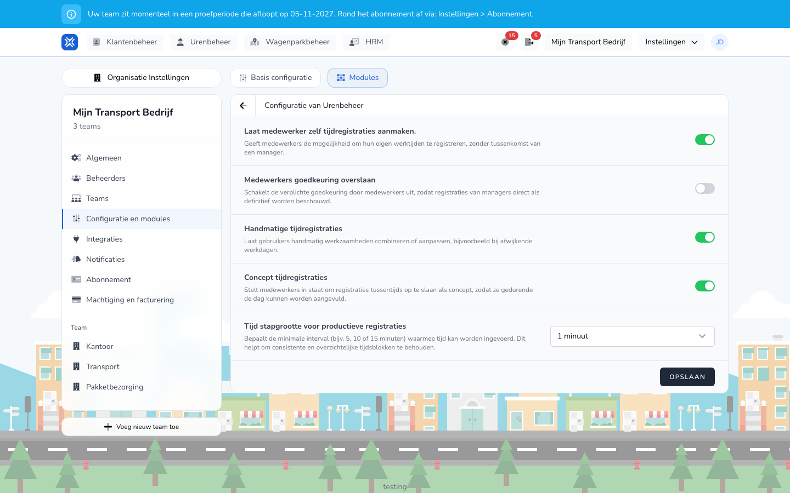

import { Hint } from '/snippets/hint.jsx';

## Waar deze pagina voor is

Uw chauffeurs en medewerkers registreren hun uren in de TransportKlok-app. Hier leest u wat u als beheerder instelt: wie de app mag gebruiken, wat medewerkers in de app mogen doen, wat zij op de kaart zien en welke meldingen zij krijgen.

## Schermafbeelding

## Wie dit mag gebruiken

- Een beheerder van de organisatie.

## Zo gebruikt u deze pagina

Toegang geven:

1. Nodig de medewerker uit bij **Arbeidskrachten**. Zie [Uitnodigingen](/nl/management/human-resources/workers/invitations).
2. De medewerker accepteert de uitnodiging en logt in de app in. Zie [Inloggen in de app](/nl/workforce/app/login).

Instellen wat medewerkers mogen:

1. Open **Instellingen** → **Organisatie Instellingen** → **Configuratie en modules** en kies het tabblad **Modules**.
2. Klik bij **Urenbeheer** op **Instellingen**.
3. Zet de instellingen aan of uit en klik op **Opslaan**.

De kaart in de app vullen:

1. Koppel trackers of een GPS-koppeling aan uw voertuigen. Zie [Telematica](/nl/management/fleet-management/telematics/overview).
2. Uw medewerkers zien de voertuigen, personen en trailers daarna op **Kaart** in de app. Zie [Kaart](/nl/workforce/app/map).

## Velden

| Instelling bij Urenbeheer | Wat het in de app doet |
|---------------------------|------------------------|
| **Laat medewerker zelf tijdregistraties aanmaken.** | Aan: medewerkers registreren zelf hun werktijden, zonder tussenkomst van een manager. |
| **Medewerkers goedkeuring overslaan** | Aan: een registratie die een manager voor een medewerker maakt, is meteen definitief. Uit: de medewerker ziet die eerst als voorstel. |
| **Handmatige tijdregistraties** | Aan: medewerkers kunnen werkzaamheden zelf combineren of aanpassen, bijvoorbeeld bij een afwijkende werkdag. |
| **Concept tijdregistraties** | Aan: medewerkers kunnen een registratie tussentijds **Opslaan als concept**. |
| **Tijd stapgrootte voor productieve registraties** | De stap in minuten waarmee tijden worden ingevoerd, bijvoorbeeld 5 of 15 minuten. |

## Wat er daarna gebeurt

- Een medewerker met toegang ziet uw organisatie in de app en kan die openen. Zie [Organisaties en uitnodigingen](/nl/workforce/app/organizations).
- Keurt u een registratie af, dan krijgt de medewerker daarvan een e-mail. Ook als u een registratie voor een medewerker voorstelt, krijgt hij een e-mail.
- Wie welke meldingen krijgt als beheerder of manager, stelt u in bij [Notificaties](/nl/settings/organization/notifications).

## Beperkingen

- De app is voor medewerkers. Een beheerder of manager die geen medewerker is van de organisatie, kan de app niet gebruiken.
- De app gebruikt de telefoon niet als GPS-tracker. De kaart en [automatische urenregistratie](/nl/management/hour-management/automatic-time-registrations) gebruiken alleen de gegevens van uw trackers en GPS-koppelingen.
- De app vraagt medewerkers om pushmeldingen toe te staan. <Hint kind="grey">Meldingen over registraties komen op dit moment per e-mail binnen, niet als pushmelding.</Hint>
