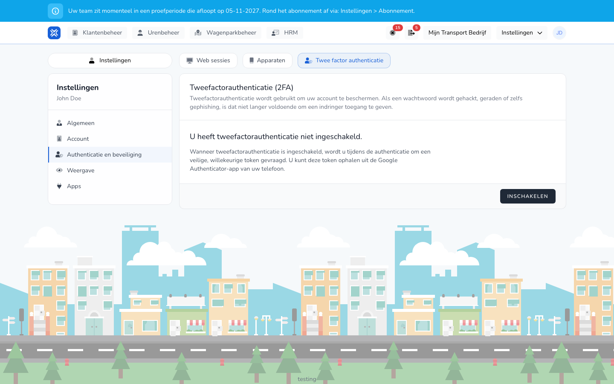

import { Hint } from '/snippets/hint.jsx';

## Waar deze pagina voor is

Hier zet u tweefactorauthenticatie aan. TransportKlok vraagt dan bij het inloggen ook om een code uit een app op uw telefoon.

## Schermafbeelding

## Wie dit mag gebruiken

- Iedere gebruiker, voor het eigen account.

## Zo gebruikt u deze pagina

1. Klik rechtsboven op uw initialen en kies **Instellingen** → **Authenticatie en beveiliging**.
2. Open het tabblad **Twee factor authenticatie** en klik op **Inschakelen**.
3. Scan de QR-code met een authenticator-app op uw telefoon, zoals Google Authenticator. Of kopieer de **Instelsleutel** naar de app.
4. Vul de 6-cijferige **Authenticatorcode** uit de app in en klik op **Installatie bevestigen**.
5. Bewaar de herstelcodes op een veilige plek. <Hint kind="red">Met een herstelcode komt u in uw account als u uw telefoon kwijt bent. Zonder herstelcode lukt dat niet.</Hint>

## Velden

| Wat u ziet | Betekenis |
|------------|-----------|
| Status | Of tweefactorauthenticatie aan staat. |
| **Toon herstelcodes** | Toont uw herstelcodes. |
| **Herstelcodes opnieuw genereren** | Maakt nieuwe herstelcodes. |
| **QR-code tonen** | Toont de QR-code opnieuw. |
| **Uitschakelen** | Zet tweefactorauthenticatie uit. |

## Wat er daarna gebeurt

- Bij het inloggen vraagt TransportKlok ook om een code uit de app. Zie [Inloggen met tweefactorauthenticatie](/nl/sign-in/two-factor).
- Na het aanzetten wordt u op uw andere apparaten en browsers uitgelogd. Daarna logt u daar opnieuw in met de code.

## Beperkingen

- Voor herstelcodes, de QR-code en uitschakelen vraagt TransportKlok eerst uw wachtwoord.
