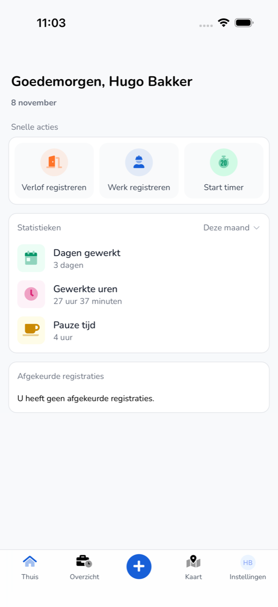

## Waar deze pagina voor is

**Thuis** is het eerste scherm na het inloggen. Hier start u een registratie en ziet u hoeveel u hebt gewerkt.

## Schermafbeelding

## Wie dit mag gebruiken

- Iedere medewerker die de app gebruikt.

## Zo gebruikt u deze pagina

1. Tik onderaan op **Thuis**.
2. Kies bij **Snelle acties** wat u wilt doen:
   - **Verlof registreren**. Zie [Verlof registreren](/nl/workforce/app/register-leave).
   - **Werk registreren**. Zie [Werk registreren](/nl/workforce/app/register-work).
   - **Start timer**. Zie [Timer](/nl/workforce/app/timer).
3. Kies bij **Statistieken** de periode, bijvoorbeeld **Deze maand**.
4. Kijk bij **Afgekeurde registraties** of uw werkgever registraties heeft afgekeurd.

## Velden

| Onderdeel | Wat u ziet |
|-----------|------------|
| **Dagen gewerkt** | Het aantal dagen dat u in de gekozen periode hebt gewerkt. |
| **Gewerkte uren** | Uw gewerkte uren in de gekozen periode. |
| **Pauze tijd** | Uw pauzes in de gekozen periode. |
| **Afgekeurde registraties** | Uw registraties die zijn afgekeurd, of "U heeft geen afgekeurde registraties." |

Onderaan staat de menubalk:

| Knop | Wat u daar doet |
|------|-----------------|
| **Thuis** | Terug naar dit scherm. |
| **Overzicht** | Uw registraties per week. Zie [Overzicht](/nl/workforce/app/overview). |
| **+** | Een nieuwe registratie maken. Zie [Werk registreren](/nl/workforce/app/register-work). |
| **Kaart** | Collega's, voertuigen en trailers op de kaart. Zie [Kaart](/nl/workforce/app/map). |
| **Instellingen** | Uw profiel, account en beveiliging. Zie [Instellingen](/nl/workforce/app/settings). |

## Wat er daarna gebeurt

- Een afgekeurde registratie past u aan via [Overzicht](/nl/workforce/app/overview).

## Beperkingen

- U ziet hier alleen uw eigen uren en registraties.
- **Start timer** ziet u alleen als uw organisatie meedoet aan het bètaprogramma.
