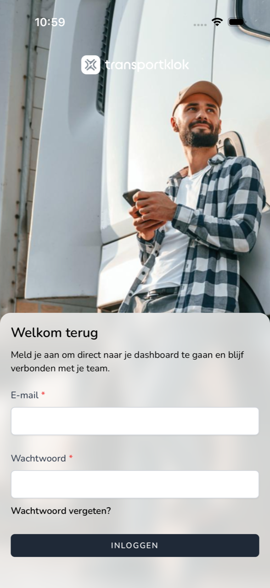
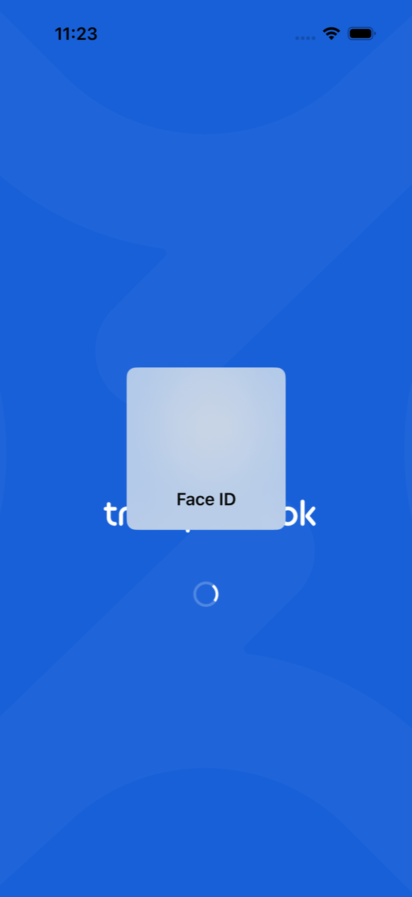

import { Hint } from '/snippets/hint.jsx';

## Waar deze pagina voor is

Hier leest u hoe u inlogt in de TransportKlok-app op uw telefoon, en hoe de app daarna uw gezicht of vingerafdruk gebruikt.

## Schermafbeelding

## Wie dit mag gebruiken

- Iedere medewerker met een TransportKlok-account. Hebt u nog geen account, accepteer dan eerst de uitnodiging van uw werkgever. Zie [Uitnodiging accepteren](/nl/sign-in/accept-invitation).

## Zo gebruikt u deze pagina

Inloggen:

1. Open de TransportKlok-app. U ziet **Welkom terug**.
2. Vul uw **E-mail** en **Wachtwoord** in en tik op **Inloggen**.
3. Heeft uw telefoon Face ID, Touch ID of een vingerafdruk ingesteld, dan vraagt de telefoon die nu. Kijk naar uw telefoon of leg uw vinger op de sensor.
4. Staat tweefactorauthenticatie aan, vul dan de code uit uw authenticator-app in en tik op **Log in**. Hebt u de app niet bij de hand, tik dan op **Use a recovery code** en vul een herstelcode in.

Wachtwoord vergeten:

1. Tik op **Wachtwoord vergeten?**.
2. Vul uw e-mailadres in en tik op **E-mail Wachtwoord Reset Link**.
3. Open de e-mail en stel een nieuw wachtwoord in. Tik daarna in de app op **Terug naar inloggen**.

## Velden

| Veld | Wat u invult |
|------|--------------|
| **E-mail** | Het e-mailadres van uw TransportKlok-account. |
| **Wachtwoord** | Uw wachtwoord. |

## Wat er daarna gebeurt

- Na het inloggen vraagt de app één keer of u pushmeldingen wilt. Zie [Pushmeldingen](/nl/workforce/app/push-notifications). Daarna ziet u **Thuis**. Zie [Thuis](/nl/workforce/app/home).
- Hebt u Face ID of een vingerafdruk, dan vraagt de app die ook als u de app later weer opent en als uw sessie wordt vernieuwd. U hoeft dan uw wachtwoord niet opnieuw in te vullen.

- Ziet u **Sneller en veiliger inloggen**, tik dan op **Gezichts-ID inschakelen** (of de naam van uw vingerafdruk) om dit aan te zetten, of op **Overslaan**.
- Hebt u uw e-mailadres nog niet bevestigd, dan vraagt de app daarom. Klik op de link in de e-mail en tik op **Verversen**, of tik op **Verificatie e-mail opnieuw verzenden**.

## Beperkingen

- Na een paar foute pogingen ziet u "Te veel inlogpogingen. Wacht alstublieft 1 minuut."
- Ziet u bij het openen **Sessie niet hersteld**, tik dan op **Opnieuw inloggen** en log in met uw e-mailadres en wachtwoord.
- Hebt u geen Face ID, Touch ID of vingerafdruk ingesteld, dan logt u alleen met uw wachtwoord in. <Hint kind="grey">Zet u later Face ID of een vingerafdruk aan op uw telefoon, dan gebruikt de app die vanaf de volgende keer dat u inlogt.</Hint>
