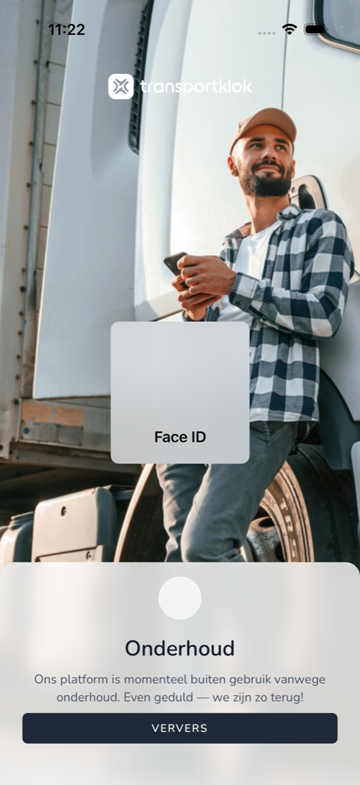

import { Hint } from '/snippets/hint.jsx';

## Waar deze pagina voor is

Soms kan de app niet verder. Dan ziet u een scherm dat zegt waarom. Hier leest u wat elk scherm betekent en wat u doet.

## Schermafbeelding

## Wie dit mag gebruiken

- Iedere medewerker die de app gebruikt.

## Zo gebruikt u deze pagina

1. Lees de titel van het scherm.
2. Zoek die titel op in de tabel hieronder en doe wat erbij staat.

## Velden

| Scherm | Wat het betekent | Wat u doet |
|--------|------------------|------------|
| **Je bent offline** | Uw telefoon heeft geen internet. | Zet wifi of mobiele data aan en tik op **Ververs**. |
| **Onderhoud** | TransportKlok is even buiten gebruik voor onderhoud. | Wacht even en tik op **Ververs**. |
| **Dienst onbereikbaar** | De app krijgt geen verbinding met TransportKlok. | Probeer het zo opnieuw met **Ververs**. |
| **Update vereist** | Deze versie van de app werkt niet meer. | Werk de app bij in de App Store of Google Play. |
| **TransportKlok wordt bijgewerkt** | De app downloadt en installeert een nieuwe versie. | Laat de app open tot dit klaar is. |
| **Sessie niet hersteld** | De app kon u niet automatisch weer aanmelden. | Tik op **Opnieuw inloggen**. |

## Wat er daarna gebeurt

- Als het weer werkt, gaat de app verder waar u was.

## Beperkingen

- Zolang u een van deze schermen ziet, kunt u niets registreren. <Hint kind="yellow">Duurt **Onderhoud** of **Dienst onbereikbaar** lang, noteer uw uren dan en registreer ze later.</Hint>
