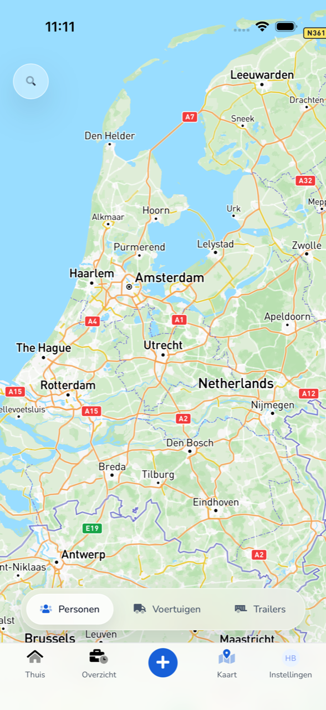
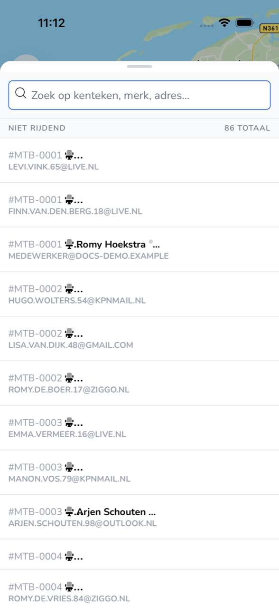

## Waar deze pagina voor is

Op **Kaart** ziet u waar collega's, voertuigen en trailers van uw organisatie zijn.

## Schermafbeelding

## Wie dit mag gebruiken

- Iedere medewerker die de app gebruikt.

## Zo gebruikt u deze pagina

1. Tik onderaan op **Kaart**.
2. Kies onderaan **Personen**, **Voertuigen** of **Trailers**.
3. Tik linksboven op het vergrootglas om de lijst te openen.
4. Zoek op kenteken, merk of adres.

## Velden

| Onderdeel | Wat u ziet |
|-----------|------------|
| **Personen** | Collega's met hun voertuig. |
| **Voertuigen** | De voertuigen van uw organisatie. |
| **Trailers** | De trailers van uw organisatie. |
| Groep, zoals **Niet rijdend** | Of iemand of iets rijdt. Rechts staat het totaal. |

## Wat er daarna gebeurt

- Met **Personen**, **Voertuigen** of **Trailers** wisselt u wat de kaart en de lijst tonen.

## Beperkingen

- Op de kaart kijkt u alleen. Voertuigen en trailers wijzigt uw werkgever in TransportKlok.
- De kaart toont de gegevens van de trackers en GPS-koppelingen van uw werkgever. De app gebruikt uw telefoon niet als GPS-tracker.
