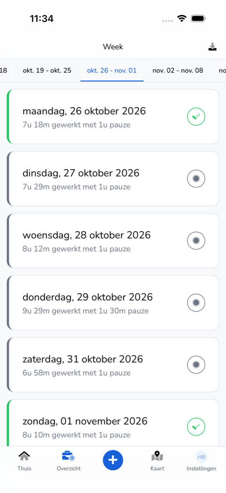
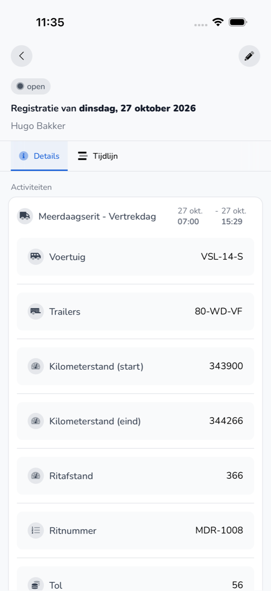

import { Hint } from '/snippets/hint.jsx';

## Waar deze pagina voor is

In **Overzicht** ziet u uw registraties per week. Hier opent u een registratie en wijzigt u er een die nog open staat.

## Schermafbeelding

## Wie dit mag gebruiken

- Iedere medewerker die de app gebruikt, voor de eigen registraties.

## Zo gebruikt u deze pagina

Een registratie bekijken:

1. Tik onderaan op **Overzicht**.
2. Kies bovenaan de week.
3. Tik op een dag. U ziet de registratie met de tabbladen **Details** en **Tijdlijn**.

Een registratie wijzigen:

1. Open een registratie die nog open staat.
2. Tik rechtsboven op het potlood.
3. Pas de gegevens aan en tik op **Afronden**.

## Velden

| Onderdeel | Wat u ziet |
|-----------|------------|
| Dag | De datum, hoeveel u werkte en hoeveel pauze u had. |
| Groen vinkje | De registratie is goedgekeurd. |
| Grijze stip | De registratie staat open en wacht op goedkeuring. |
| **Totaal** | Uw gewerkte uren, pauze en afwezigheid in die week. |
| **Details** | De werkzaamheden met tijden, voertuig en ritgegevens, en uw pauze. |
| **Tijdlijn** | Wie de registratie wanneer heeft aangemaakt, gewijzigd of goedgekeurd. |

## Wat er daarna gebeurt

- Na een wijziging ziet u "Tijdregistratie bijgewerkt".
- Een goedgekeurde registratie krijgt een groen vinkje.

## Beperkingen

- Alleen een registratie die open staat, kunt u wijzigen. <Hint kind="yellow">Is een registratie al goedgekeurd en klopt er iets niet, vraag uw werkgever dan om die aan te passen.</Hint>
