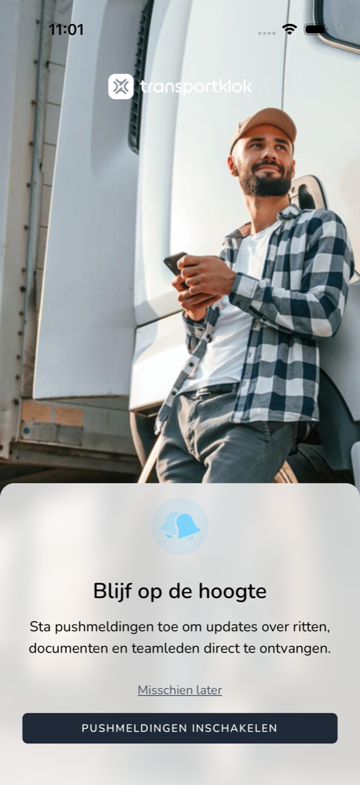

## Waar deze pagina voor is

Met pushmeldingen krijgt u berichten van TransportKlok op uw telefoon, ook als de app dicht is. Hier leest u hoe u ze aanzet.

## Schermafbeelding

## Wie dit mag gebruiken

- Iedere medewerker die de app gebruikt.

## Zo gebruikt u deze pagina

1. Na uw eerste keer inloggen ziet u **Blijf op de hoogte**.
2. Tik op **Pushmeldingen inschakelen**.
3. Uw telefoon vraagt of TransportKlok meldingen mag sturen. Tik op `Sta toe` (op Android: **Toestaan**).

Wilt u dit later beslissen, tik dan op **Misschien later**.

## Velden

| Knop | Wat er gebeurt |
|------|----------------|
| **Pushmeldingen inschakelen** | Uw telefoon vraagt om toestemming voor meldingen. |
| **Misschien later** | U gaat verder zonder meldingen. De app vraagt het later nog eens. |

## Wat er daarna gebeurt

- Met toestemming krijgt u meldingen van TransportKlok op uw telefoon.
- Koos u **Misschien later**, dan vraagt de app na een tijd opnieuw met `Push notificaties`.

## Beperkingen

- Hebt u meldingen geweigerd in de vraag van uw telefoon, dan zet u ze alleen weer aan in de instellingen van uw telefoon, bij TransportKlok. De app laat dan `Push notificaties uitgeschakeld` zien als herinnering.
