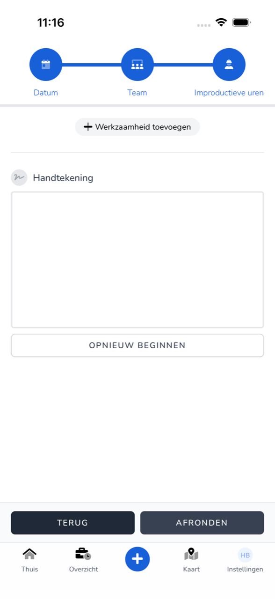

import { Hint } from '/snippets/hint.jsx';

## Waar deze pagina voor is

Hier registreert u uren waarop u niet werkte, zoals verlof, ziekte, een feestdag of rusttijd.

## Schermafbeelding

## Wie dit mag gebruiken

- Iedere medewerker die de app gebruikt.

## Zo gebruikt u deze pagina

1. Tik op **Thuis** op **Verlof registreren**. **Improductief (verlof, overstaan of rusttijd)** staat al gekozen.
2. Kies de **Datum** en tik op **Volgende**.
3. Kies bij **Team** uw team en tik op **Volgende**.
4. Tik bij **Improductieve uren** op **Werkzaamheid toevoegen** en kies het soort uren.
5. Vul de tijden in en zet uw **Handtekening**.
6. Tik op **Afronden**.

## Velden

| Soort uren | Wanneer u dit kiest |
|------------|---------------------|
| **ATV** | Arbeidstijdverkorting. |
| **Verlof** | Gewoon verlof. |
| **Bijzonder verlof** | Verlof voor een bijzondere gebeurtenis. |
| **Ziek** | U was ziek. |
| **Feestdag** | Een erkende feestdag. |
| **Onbetaald verlof** | Verlof zonder loon. |
| **Overstaan** | Wachttijd buiten uw schuld. |
| **Consignatiedienst** | U was oproepbaar. |
| **Rusttijd** | Uw verplichte rusttijd. |

<Hint kind="grey">Welke soorten u ziet, hangt af van wat uw werkgever voor uw team heeft ingesteld.</Hint>

## Wat er daarna gebeurt

- De registratie staat in [Overzicht](/nl/workforce/app/overview) en wacht op goedkeuring van uw werkgever.

## Beperkingen

- Is de salarisperiode van die dag al verwerkt, dan kunt u er geen uren meer voor registreren.
