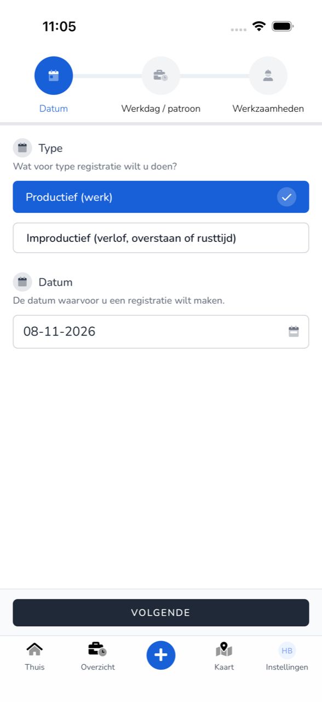
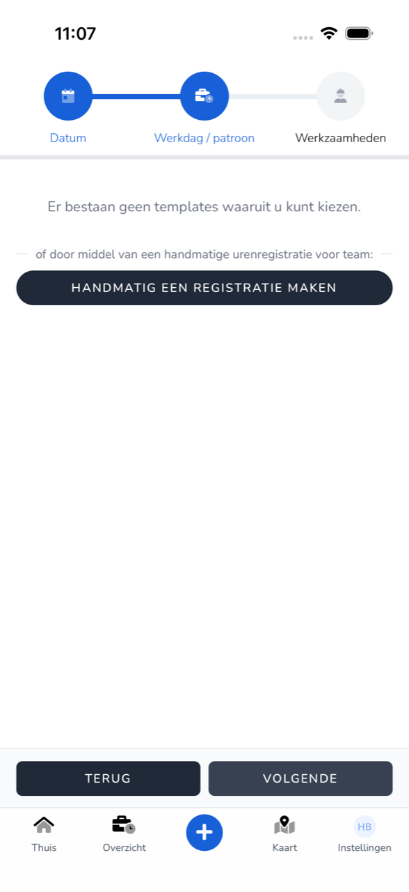
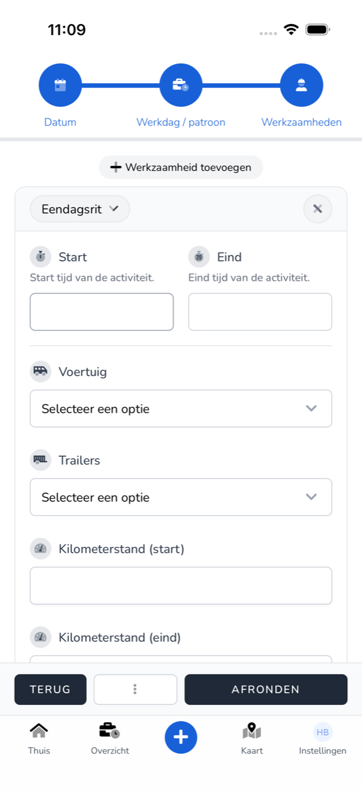

import { Hint } from '/snippets/hint.jsx';

## Waar deze pagina voor is

Hier registreert u in de app wat u op een dag hebt gedaan: uw werkzaamheden, tijden en ritgegevens.

## Schermafbeelding

## Wie dit mag gebruiken

- Iedere medewerker die de app gebruikt.

## Zo gebruikt u deze pagina

1. Tik op **Thuis** op **Werk registreren**, of onderaan op `+`.
2. Kies bij **Type** voor **Productief (werk)**.
3. Tik op **Datum** en kies de dag. Tik op **Opslaan** en dan op **Volgende**.
4. Kies bij **Werkdag / patroon** een sjabloon, of tik op **Handmatig een registratie maken** en kies uw team. Tik op **Volgende**.
5. Tik bij **Werkzaamheden** op **Werkzaamheid toevoegen** en kies wat u deed, bijvoorbeeld **Eendagsrit**.
6. Vul de velden van de werkzaamheid in. Voeg zo nodig meer werkzaamheden toe.
7. Vul **Pauze (minuten)** in, eventueel een **Memo**, en zet uw **Handtekening**.
8. Tik op **Afronden**.

## Velden

| Veld | Wat u invult |
|------|--------------|
| **Type** | **Productief (werk)** voor gewerkte uren. Voor verlof kiest u **Improductief**, zie [Verlof registreren](/nl/workforce/app/register-leave). |
| **Datum** | De dag van de registratie. In de kalender kiest u een **Dag**, een **Periode** of losse **Dagen**. |
| **Start**, **Eind** | De begin- en eindtijd van de werkzaamheid. |
| **Voertuig**, **Trailers** | Het voertuig en de trailers waarmee u reed. |
| **Kilometerstand (start)**, **Kilometerstand (eind)** | De kilometerstand bij vertrek en aankomst. |
| **Ritnummer**, **Getankte brandstof**, **Getankte AdBlue**, **Tol** | De gegevens van uw rit. |
| **Memo** | Een opmerking bij de registratie. |
| **Pauze (minuten)** | Uw pauze in minuten. |
| **Handtekening** | Zet uw handtekening met uw vinger. |

<Hint kind="grey">Welke velden u ziet en welke verplicht zijn, hangt af van de werkzaamheid en van wat uw werkgever voor uw team heeft ingesteld.</Hint>

## Wat er daarna gebeurt

- De registratie staat in [Overzicht](/nl/workforce/app/overview) en wacht op goedkeuring van uw werkgever.
- Mist er iets, dan ziet u onder het veld wat u nog moet invullen, bijvoorbeeld "Vul een begintijd in."

## Beperkingen

- Bent u nog niet klaar, tik dan op `⋮` en **Opslaan als concept**. Met `Opnieuw beginnen` begint u de registratie opnieuw.
- Is de salarisperiode van die dag al verwerkt, dan ziet u "Deze registratie kan niet worden aangepast omdat de loonperiode al is goedgekeurd of verwerkt." <Hint kind="yellow">Neem dan contact op met uw werkgever.</Hint>
