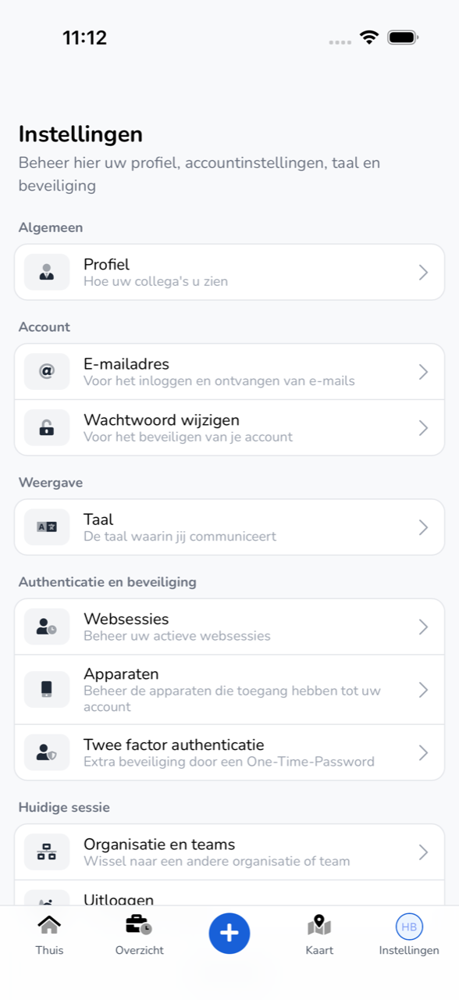
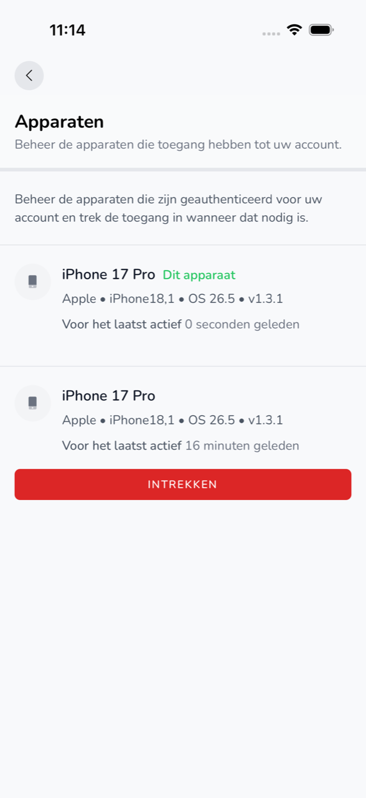

import { Hint } from '/snippets/hint.jsx';

## Waar deze pagina voor is

In **Instellingen** beheert u uw profiel, uw account, de taal van de app en de beveiliging van uw account.

## Schermafbeelding

## Wie dit mag gebruiken

- Iedere medewerker die de app gebruikt.

## Zo gebruikt u deze pagina

1. Tik onderaan op **Instellingen**.
2. Tik op het onderdeel dat u wilt aanpassen.
3. Pas het aan en tik op **Opslaan**.

## Velden

| Onderdeel | Wat u daar doet |
|-----------|-----------------|
| **Profiel** | Uw **Profielfoto** kiezen of verwijderen, en uw **Naam** aanpassen. |
| **E-mailadres** | Het e-mailadres waarmee u inlogt wijzigen. |
| **Wachtwoord wijzigen** | Uw **Huidige wachtwoord** en een nieuw **Wachtwoord** invullen en bevestigen. |
| **Taal** | De taal van de app kiezen: Nederlands, English, Deutsch, Polski of Română. |
| **Websessies** | Met **Andere browser sessies uitloggen** logt u overal anders uit. |
| **Apparaten** | De telefoons die toegang hebben tot uw account. Met **Intrekken** haalt u een telefoon eraf. |
| **Twee factor authenticatie** | Met **Inschakelen** zet u tweefactorauthenticatie aan. |
| **Organisatie en teams** | Een andere organisatie kiezen. Zie [Organisaties en uitnodigingen](/nl/workforce/app/organizations). |
| **Update toepassen** | Een nieuwe versie van de app die al is gedownload nu starten. |
| **Uitloggen** | Uitloggen op deze telefoon. |

## Wat er daarna gebeurt

- Na **Opslaan** ziet u de wijziging meteen in de app.
- Na **Uitloggen** ziet u weer **Welkom terug**.

## Beperkingen

- Een nieuw wachtwoord heeft minstens 8 tekens, met minstens 1 hoofdletter, 1 cijfer en 1 speciaal teken.
- Voor **Websessies**, **Apparaten** en **Twee factor authenticatie** bevestigt u eerst uw identiteit met Face ID, Touch ID of uw vingerafdruk. <Hint kind="yellow">Hebt u dat niet ingesteld op uw telefoon, dan ziet u "Biometrische verificatie vereist" en kunt u deze onderdelen in de app niet wijzigen.</Hint>
- **Update toepassen** ziet u alleen als er een nieuwe versie klaarstaat.
