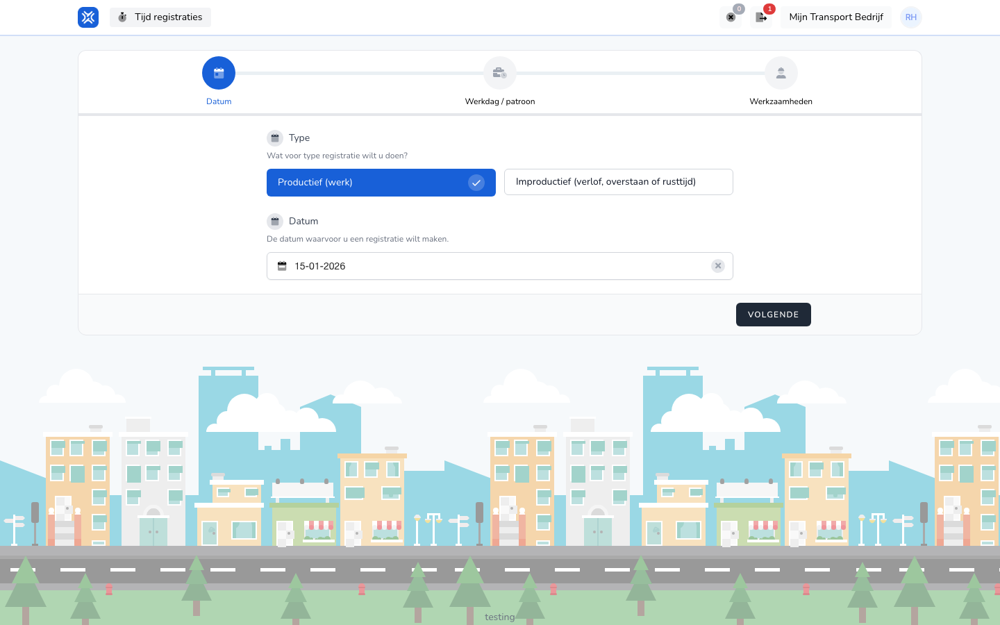

import { Hint } from '/snippets/hint.jsx';

## Waar deze pagina voor is

Hier registreert u op het web wat u op een dag hebt gedaan, of uren waarop u niet werkte, zoals verlof of ziekte. Zie voor de app [Werk registreren in de app](/nl/workforce/app/register-work).

## Schermafbeelding

## Wie dit mag gebruiken

- Een medewerker, als uw werkgever toestaat dat medewerkers zelf registreren. <Hint kind="yellow">Dat hangt af van de instelling **Laat medewerker zelf tijdregistraties aanmaken.** van uw werkgever.</Hint>

## Zo gebruikt u deze pagina

1. Klik op **Tijd registraties** op **Nieuwe registratie**.
2. Kies bij **Type** voor **Productief (werk)**, of voor **Improductief (verlof, overstaan of rusttijd)** als u verlof of andere uren registreert.
3. Kies de **Datum** en klik op **Volgende**.
4. Kies bij **Werkdag / patroon** een sjabloon of maak de registratie handmatig, en klik op **Volgende**.
5. Voeg bij **Werkzaamheden** de werkzaamheden toe met hun **Start** en **Eind**, vul eventueel **Memo** en **Pauze (minuten)** in en zet uw **Handtekening**.
6. Klik op **Afronden**.

## Velden

| Veld | Wat u invult |
|------|--------------|
| **Type** | **Productief (werk)** voor gewerkte uren, **Improductief** voor verlof, ziekte, overstaan of rusttijd. |
| **Datum** | De dag van de registratie. |
| **Start**, **Eind** | De begin- en eindtijd van een werkzaamheid. |
| **Memo** | Een opmerking. |
| **Pauze (minuten)** | Uw pauze. Bij een pauzestaffel vult TransportKlok die zelf in. |
| **Handtekening** | Zet uw handtekening met de muis of uw vinger. |

<Hint kind="grey">Welke velden en werkzaamheden u ziet, hangt af van wat uw werkgever voor uw team heeft ingesteld.</Hint>

## Wat er daarna gebeurt

- De registratie staat op **Tijd registraties** met de status **Open** tot uw werkgever haar goedkeurt.

## Beperkingen

- Verlof vraagt u niet apart aan: u registreert het als improductieve uren, en uw werkgever keurt die goed zoals elke registratie.
- Voor een dag in een salarisperiode die al is verwerkt, kunt u niets meer registreren.
