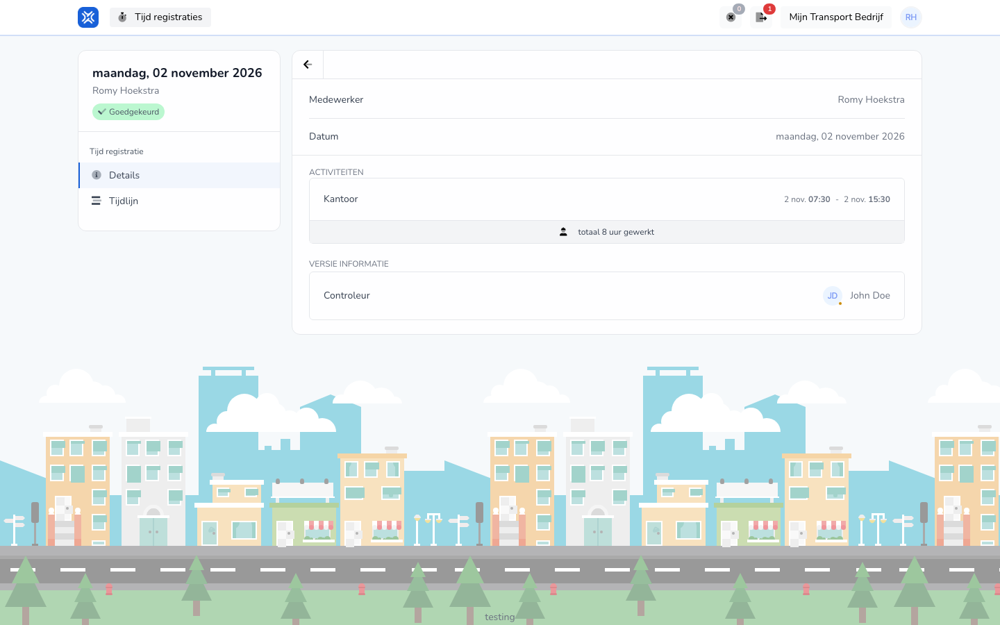

import { Hint } from '/snippets/hint.jsx';

## Waar deze pagina voor is

Hier bekijkt u één registratie: de werkzaamheden met tijden, de status en wie haar controleerde.

## Schermafbeelding

## Wie dit mag gebruiken

- Een medewerker, voor de eigen registraties.

## Zo gebruikt u deze pagina

1. Klik op **Tijd registraties** op een registratie.
2. Bekijk op **Details** de werkzaamheden en de tijden.
3. Klik op **Tijdlijn** om te zien wie wat deed. Zie [Tijdlijn](/nl/workforce/hour-management/time-registrations/timeline).
4. Staat de registratie op **Open**, kies dan **Acties** → **Wijzigen** om haar aan te passen. Zie [Registratie wijzigen](/nl/workforce/hour-management/time-registrations/edit).

## Velden

| Onderdeel | Wat u ziet |
|-----------|------------|
| Status | Bijvoorbeeld **Open** (wacht op goedkeuring) of **Goedgekeurd**. |
| **Medewerker**, **Datum** | Van wie en welke dag de registratie is. |
| **Activiteiten** | Elke werkzaamheid met begin- en eindtijd, en het totaal gewerkt. |
| **Versie informatie** | Bij een goedgekeurde registratie: de **Controleur** die haar goedkeurde. |

## Wat er daarna gebeurt

- Na goedkeuring ziet u de status **Goedgekeurd** en de controleur.

## Beperkingen

- Een goedgekeurde registratie kunt u niet meer wijzigen. <Hint kind="yellow">Klopt er iets niet, vraag uw werkgever dan om die aan te passen.</Hint>
