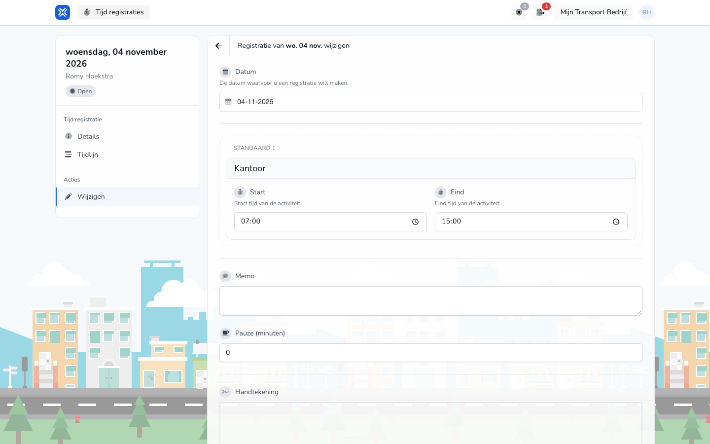

## Waar deze pagina voor is

Hier past u een registratie aan die nog niet is goedgekeurd.

## Schermafbeelding

## Wie dit mag gebruiken

- Een medewerker, voor de eigen registraties met de status **Open**.

## Zo gebruikt u deze pagina

1. Open de registratie en kies **Acties** → **Wijzigen**.
2. Pas de **Datum**, de werkzaamheden met hun **Start** en **Eind**, de **Memo** of de **Pauze (minuten)** aan.
3. Zet opnieuw uw **Handtekening**.
4. Klik op **Afronden**. Met **Opnieuw beginnen** zet u alles terug.

## Velden

| Veld | Wat u invult |
|------|--------------|
| **Datum** | De dag van de registratie. |
| **Start**, **Eind** | De tijden van een werkzaamheid. |
| **Memo**, **Pauze (minuten)** | Een opmerking en uw pauze. |
| **Handtekening** | Uw handtekening. |

## Wat er daarna gebeurt

- De gewijzigde registratie staat weer op **Open** tot uw werkgever haar goedkeurt. De wijziging staat in de [Tijdlijn](/nl/workforce/hour-management/time-registrations/timeline).

## Beperkingen

- Alleen registraties met de status **Open** kunt u wijzigen.
