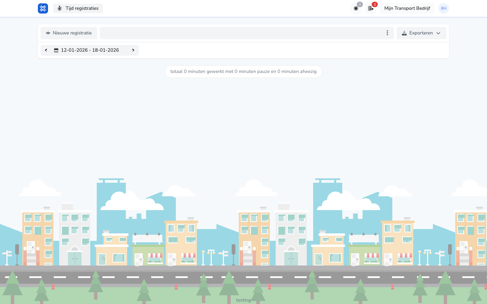

## Waar deze pagina voor is

Op **Tijd registraties** ziet u uw eigen registraties per periode, met hoeveel u werkte, pauze had en afwezig was. Zie voor de app [Overzicht in de app](/nl/workforce/app/overview).

## Schermafbeelding

## Wie dit mag gebruiken

- Iedere medewerker met een TransportKlok-account, voor de eigen registraties.

## Zo gebruikt u deze pagina

1. Log in op TransportKlok. U komt op **Tijd registraties**.
2. Kies met de pijlen naast de periode een andere week.
3. Klik op een registratie om die te openen. Zie [Registratie bekijken](/nl/workforce/hour-management/time-registrations/details).
4. Klik op **Nieuwe registratie** om uren of verlof te registreren. Zie [Registratie maken](/nl/workforce/hour-management/time-registrations/create).
5. Klik op **Exporteren** en kies **Urenverantwoording (pdf)** om uw uren van de periode als pdf te downloaden.

## Velden

| Onderdeel | Wat u ziet |
|-----------|------------|
| Registratie | De datum, hoeveel u werkte en hoeveel pauze u had, en wie de registratie maakte. |
| **totaal** | Uw gewerkte tijd, pauze en afwezigheid in de gekozen periode. |

## Wat er daarna gebeurt

- Na **Urenverantwoording (pdf)** ziet u **Wachten op export** terwijl de pdf wordt gemaakt. Daarna downloadt u hem rechtsboven bij **Exports**. Zie [Exports](/nl/general/exports).

## Beperkingen

- U ziet alleen uw eigen registraties.
