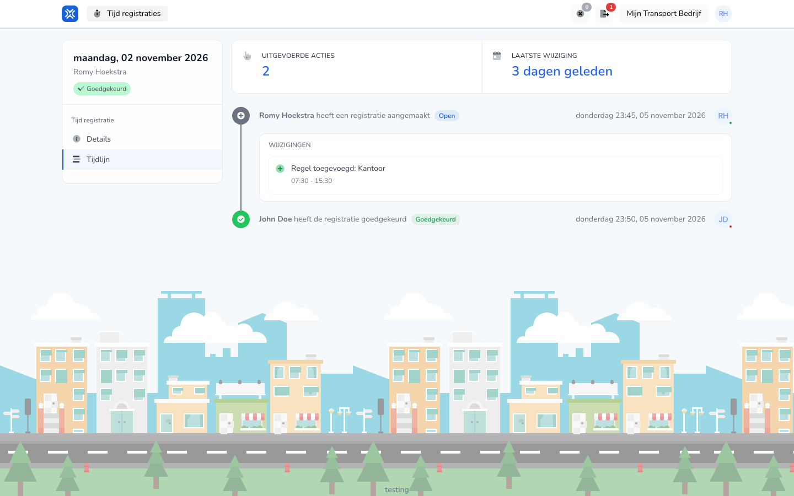

## Waar deze pagina voor is

Op **Tijdlijn** ziet u de geschiedenis van een registratie: wie haar maakte, wat er veranderde en wie haar goedkeurde.

## Schermafbeelding

## Wie dit mag gebruiken

- Een medewerker, voor de eigen registraties.

## Zo gebruikt u deze pagina

1. Open een registratie op **Tijd registraties**.
2. Klik op het tabblad **Tijdlijn**.

## Velden

| Onderdeel | Wat u ziet |
|-----------|------------|
| **Uitgevoerde acties** | Hoeveel acties er op de registratie zijn gedaan. |
| **Laatste wijziging** | Hoe lang geleden de registratie het laatst veranderde. |
| Acties | Per actie wie die deed, wanneer, en de status daarna, bijvoorbeeld "heeft de registratie goedgekeurd". |
| **Wijzigingen** | Wat er bij een actie veranderde, zoals een toegevoegde regel met tijden. |

## Wat er daarna gebeurt

- Elke nieuwe wijziging of goedkeuring komt bovenaan de tijdlijn bij.

## Beperkingen

- De tijdlijn kunt u alleen bekijken, niet aanpassen.
