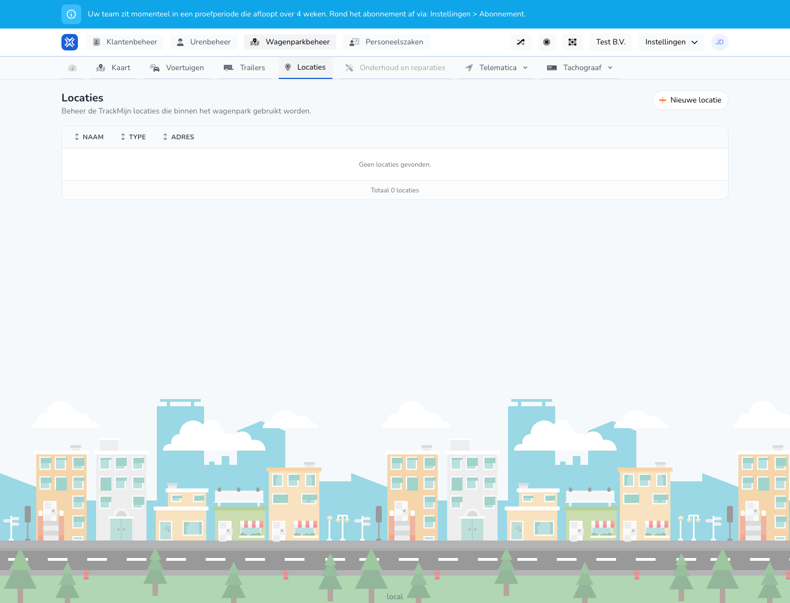

{/* translated-from: nl/management/fleet-management/locations/overview.mdx sha256:b966ab667e0587862ca78e7bc26869c0f7bd9af39984a70e8867f1eb23ada01b */}

## Do czego służy ta strona

Tutaj zarządza się lokalizacjami używanymi we flocie.

## Co można tutaj zrobić

- Przeglądać lokalizacje.
- Dodać nową lokalizację.

## Zrzut ekranu

## Co widać na stronie

- Przycisk **Nowa lokalizacja**.
- Krótkie objaśnienie dotyczące korzystania z lokalizacji TrackMijn.
- Tabelę z nazwą, typem i adresem.

## Jak korzystać z tej strony

1. Otworzyć **Lokalizacje**.
2. Sprawdzić, czy lokalizacja już istnieje.
3. Kliknąć **Nowa lokalizacja**, aby dodać kolejną lokalizację.

## Co dzieje się potem

- Po dodaniu lokalizacja pojawia się w przeglądzie.
- Lokalizacje można następnie wybierać w innych procesach.

## Warto wiedzieć

- Jeśli nie ma jeszcze żadnych lokalizacji, widoczny jest pusty stan z wyraźnym komunikatem.
- Należy używać rozpoznawalnych nazw lokalizacji, aby współpracownicy łatwo je znajdowali.

## Powiązane strony

- Dodawanie lokalizacji
- Mapa

