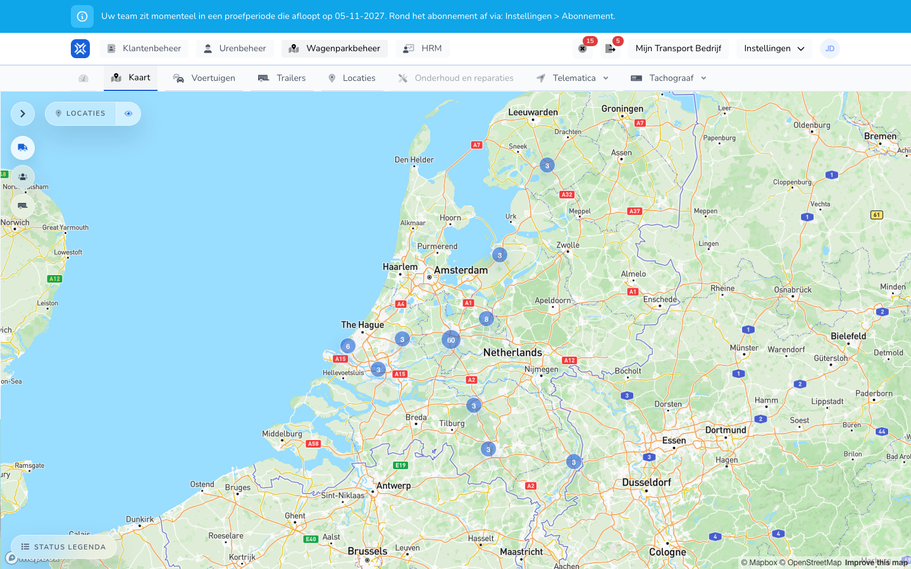

{/* translated-from: nl/management/fleet-management/map.mdx sha256:7cd3c9d8f22d2db317a31739d488e8cd05ff7d3da4916dd7ecd277209caf136c */}

## Do czego służy ta strona

Ta strona pomaga przeglądać pojazdy na mapie i na liście. Dzięki temu łatwiej znaleźć szukany pojazd.

## Co można tutaj zrobić

- Rozpoznawać pojazdy po nazwie i numerze rejestracyjnym.
- Na podstawie widoku mapy zdecydować, który pojazd otworzyć dalej.

## Zrzut ekranu

## Co widać na stronie

- Część z mapą i oznaczeniami pojazdów.
- Listę nazw pojazdów i numerów rejestracyjnych obok mapy lub pod nią.

## Jak korzystać z tej strony

1. Otworzyć stronę **Mapa**.
2. Znaleźć na liście potrzebny pojazd.
3. Za pomocą mapy ocenić położenie lub rozmieszczenie pojazdów.
4. Następnie przejść do **Pojazdy**, aby zmienić dane.

## Co dzieje się potem

- Szybciej widać, który pojazd gdzie stoi lub gdzie powinien być.
- Następnie można celniej przejść do właściwego ekranu pojazdu.

## Warto wiedzieć

- Ta strona służy przede wszystkim do przeglądu i rozpoznawania.
- Do zmian danych pojazdów służy część poświęcona pojazdom.

## Powiązane strony

- Przegląd pojazdów
- Przegląd lokalizacji

