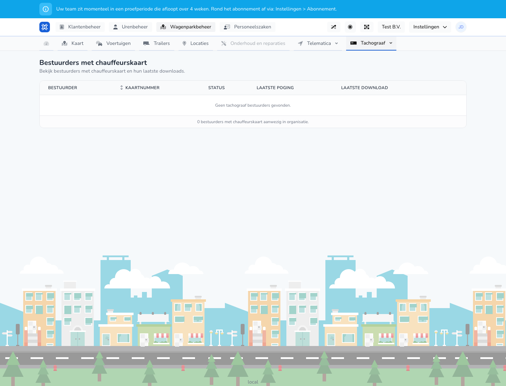

{/* translated-from: nl/management/fleet-management/tachograph/drivers.mdx sha256:96c9a6671ab024e92bfa5b673514fe79156ba0616f424ea08bf9bb5982f8caa1 */}

## Do czego służy ta strona

Na tej stronie widać kierowców z kartą kierowcy i momenty ich ostatnich pobrań.

## Co można tutaj zrobić

- Przeglądać kierowców i numery kart.
- Sprawdzać status pobierania.

## Zrzut ekranu

## Co widać na stronie

- Tabelę z kierowcą, numerem karty, statusem, ostatnią próbą i ostatnim pobraniem.

## Jak korzystać z tej strony

1. Otworzyć **Kierowcy z kartą kierowcy**.
2. Dla każdego kierowcy sprawdzić, czy status pobierania jest aktualny.
3. Po numerze karty i nazwisku rozpoznać właściwego kierowcę.

## Co dzieje się potem

- Od razu widać, którzy kierowcy wymagają jeszcze uwagi.

## Warto wiedzieć

- Tej strony należy używać przede wszystkim do kontroli i dalszych działań.

## Powiązane strony

- Pojazdy z tachografem
- Karty przedsiębiorstwa do tachografu

