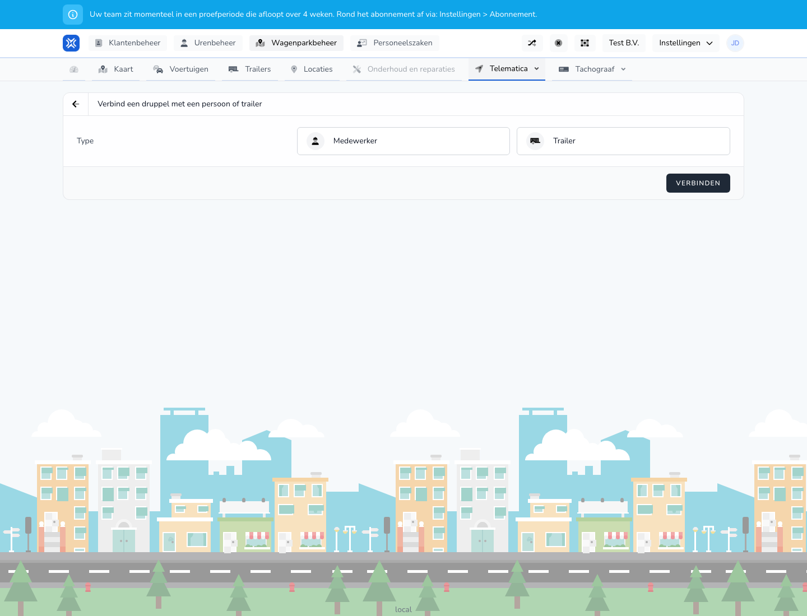

{/* translated-from: nl/management/fleet-management/telematics/beacons/connect.mdx sha256:5c45ff09fe0e5e20fdb03eb4d0f1c223bbc3e32084e8159c74362fd4ad420b84 */}

## Do czego służy ta strona

Na tej stronie łączy się beacon z odpowiednim typem obiektu.

## Co można tutaj zrobić

- Wybrać, czy beacon jest łączony z pracownikiem, czy z naczepą.
- Zapisać powiązanie.

## Zrzut ekranu

## Co widać na stronie

- Wybór typu powiązania.
- Pola dla pracownika lub naczepy.
- Przycisk **Połącz**.

## Jak korzystać z tej strony

1. Otworzyć stronę powiązania z poziomu beaconu.
2. Najpierw wybrać typ, z którym ma nastąpić powiązanie.
3. Następnie wybrać właściwego pracownika lub naczepę.
4. Kliknąć **Połącz**.

## Co dzieje się potem

- Beacon otrzymuje wyraźne powiązanie.
- To powiązanie widać potem w przeglądzie beaconów.

## Warto wiedzieć

- Zawsze należy sprawdzić, czy powiązanie dotyczy właściwego obiektu.
- Błędne powiązanie powoduje później niejasności w przeglądzie.

## Powiązane strony

- Przegląd beaconów
