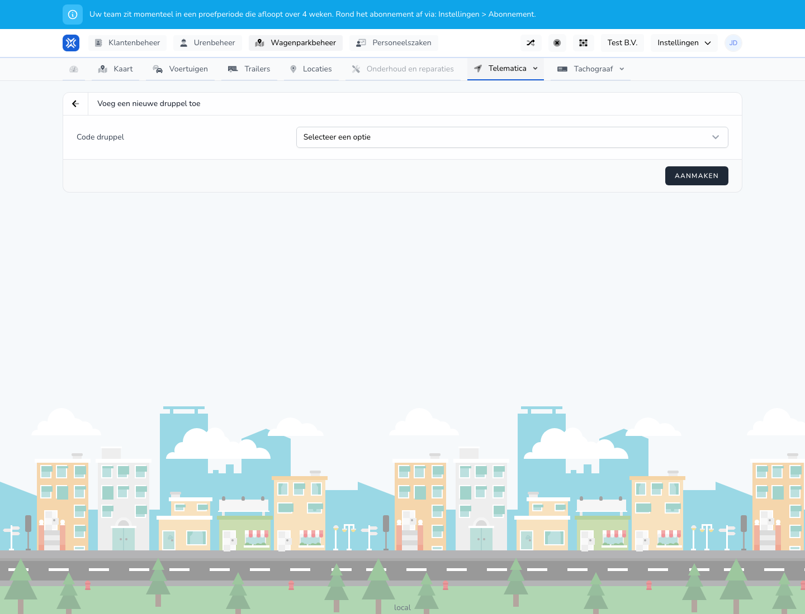

{/* translated-from: nl/management/fleet-management/telematics/beacons/create.mdx sha256:db3135f9769b74c2c1cdf48e3f0b1dfac635fe2ca0ea113590d533ad618c90b2 */}

## Do czego służy ta strona

Za pomocą tego formularza dodaje się nowy beacon.

## Co można tutaj zrobić

- Wybrać lub wpisać kod beaconu.
- Zapisać beacon.

## Zrzut ekranu

## Co widać na stronie

- Ekran **Dodaj nowy beacon**.
- Pole na kod beaconu.
- Przycisk **Utwórz**.

## Jak korzystać z tej strony

1. Otworzyć **Dodaj beacon**.
2. Wpisać lub wybrać właściwy kod.
3. Kliknąć **Utwórz**.

## Co dzieje się potem

- Beacon pojawia się w przeglądzie.
- Następnie można powiązać beacon z pracownikiem lub naczepą.

## Warto wiedzieć

- Należy użyć właściwego kodu, aby uniknąć podwójnych lub błędnych powiązań.

## Powiązane strony

- Przegląd beaconów
- Powiązanie beaconu

