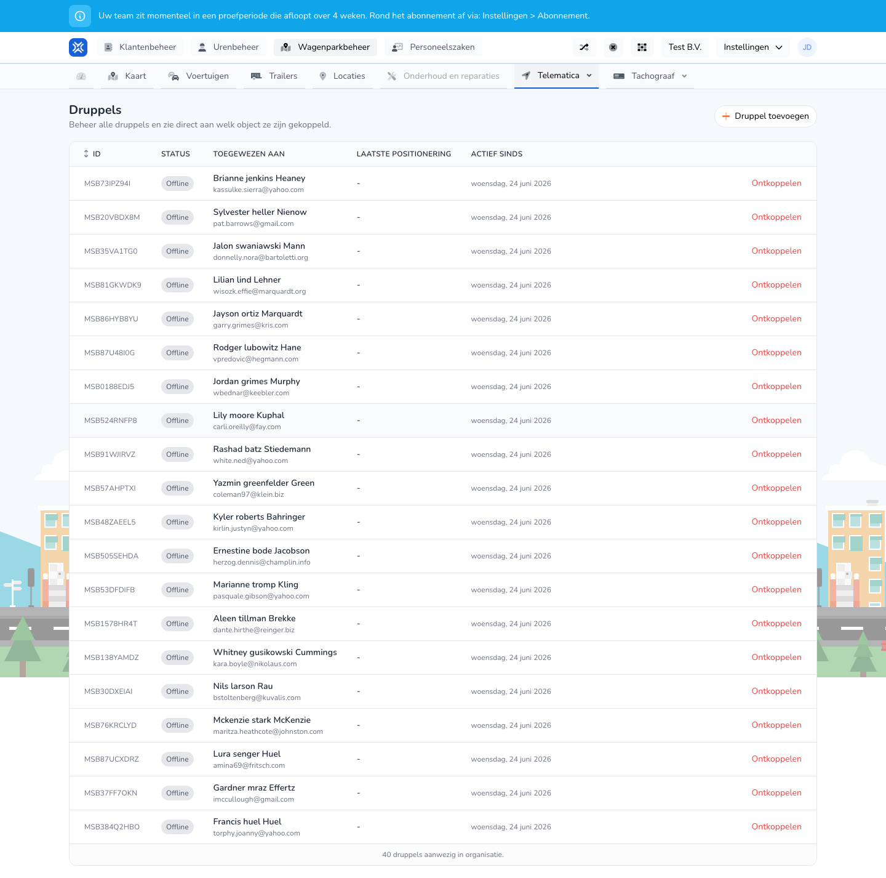

{/* translated-from: nl/management/fleet-management/telematics/beacons/overview.mdx sha256:4f366e4b6e5a6d78326b3d97ec01fa3524a40979aa74b911d82a8a3fa4a5109d */}

## Do czego służy ta strona

Tutaj widać wszystkie beacony, ich status i z jakim obiektem są powiązane.

## Co można tutaj zrobić

- Przeglądać beacony.
- Dodać beacon.
- Sprawdzić, czy beacon jest już powiązany.

## Zrzut ekranu

## Co widać na stronie

- Przycisk **Dodaj beacon**.
- Tabelę z identyfikatorem, statusem, przypisaniem, ostatnią lokalizacją i datą aktywności od.

## Jak korzystać z tej strony

1. Otworzyć **Beacony**.
2. Znaleźć właściwy beacon w tabeli.
3. Sprawdzić, czy beacon jest już powiązany.
4. Dodać nowy beacon, jeśli go jeszcze brakuje.

## Co dzieje się potem

- Widać, które beacony wymagają jeszcze uwagi.

## Warto wiedzieć

- Niepowiązane lub niedostępne beacony od razu rzucają się tutaj w oczy.

## Powiązane strony

- Dodawanie beaconu
- Powiązanie beaconu

