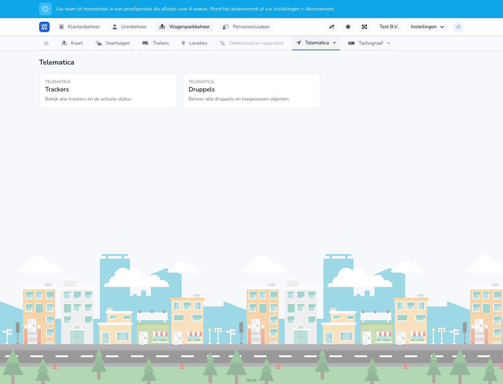

{/* translated-from: nl/management/fleet-management/telematics/overview.mdx sha256:40c0fe7135e6fd87d57b6f3b53e74856ba764381f6d6f00be80f5868d7a79263 */}

## Do czego służy ta strona

Na tej stronie wybiera się, czy dalej pracować z lokalizatorami, czy z beaconami.

## Co można tutaj zrobić

- Przejść do przeglądu lokalizatorów.
- Przejść do przeglądu beaconów.

## Zrzut ekranu

## Co widać na stronie

- Dwa wyraźne kafelki lub bloki: **Lokalizatory** i **Beacony**.
- Krótkie objaśnienie każdej części.

## Jak korzystać z tej strony

1. Otworzyć **Telematyka**.
2. Wybrać **Lokalizatory**, aby zarządzać lokalizatorami pojazdów.
3. Wybrać **Beacony**, aby zarządzać beaconami lub je powiązać.

## Co dzieje się potem

- Następuje przejście do wybranej części telematyki.

## Warto wiedzieć

- Ten ekran służy jako punkt wyjścia w telematyce.
- Właściwe działania zarządcze znajdują się na kolejnych ekranach.

## Powiązane strony

- Przegląd lokalizatorów
- Przegląd beaconów

