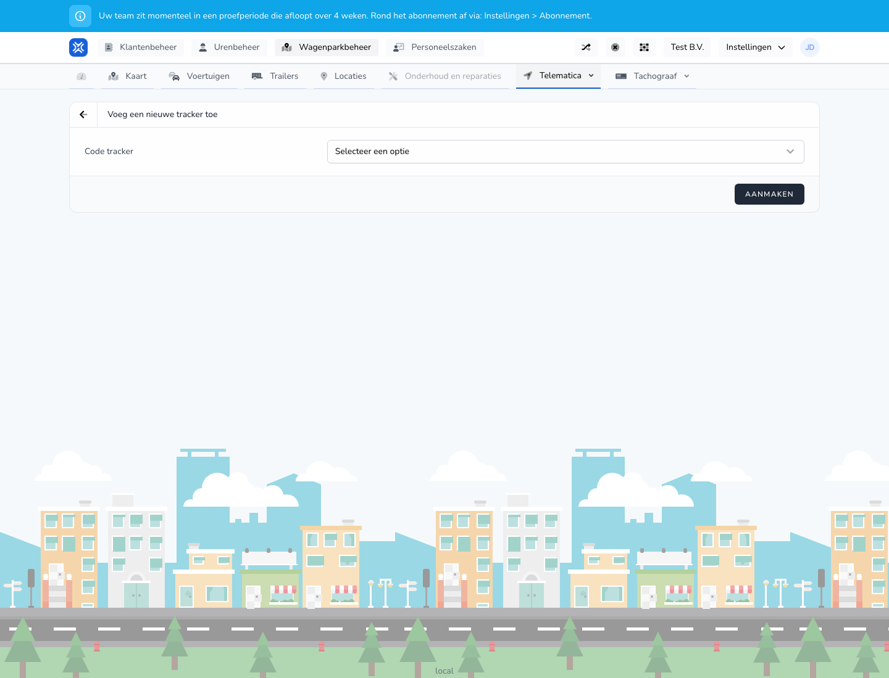

{/* translated-from: nl/management/fleet-management/telematics/trackers/create.mdx sha256:983178bf31db5dc6615bf8359e10c287fd6cdc6c427a04cd0ae1c1a4390d9cc7 */}

## Do czego służy ta strona

Za pomocą tego formularza dodaje się lokalizator.

## Co można tutaj zrobić

- Wybrać lub wpisać kod lokalizatora.
- Zapisać lokalizator.

## Zrzut ekranu

## Co widać na stronie

- Ekran **Dodaj nowy lokalizator**.
- Pole na kod lokalizatora.
- Przycisk **Utwórz**.

## Jak korzystać z tej strony

1. Otworzyć **Dodaj lokalizator**.
2. Wpisać lub wybrać właściwy kod lokalizatora.
3. Kliknąć **Utwórz**.

## Co dzieje się potem

- Lokalizator pojawia się w przeglądzie.
- Następnie można sprawdzić status i powiązanie.

## Warto wiedzieć

- Należy użyć właściwego kodu lokalizatora, aby uniknąć późniejszych pomyłek.

## Powiązane strony

- Przegląd lokalizatorów

