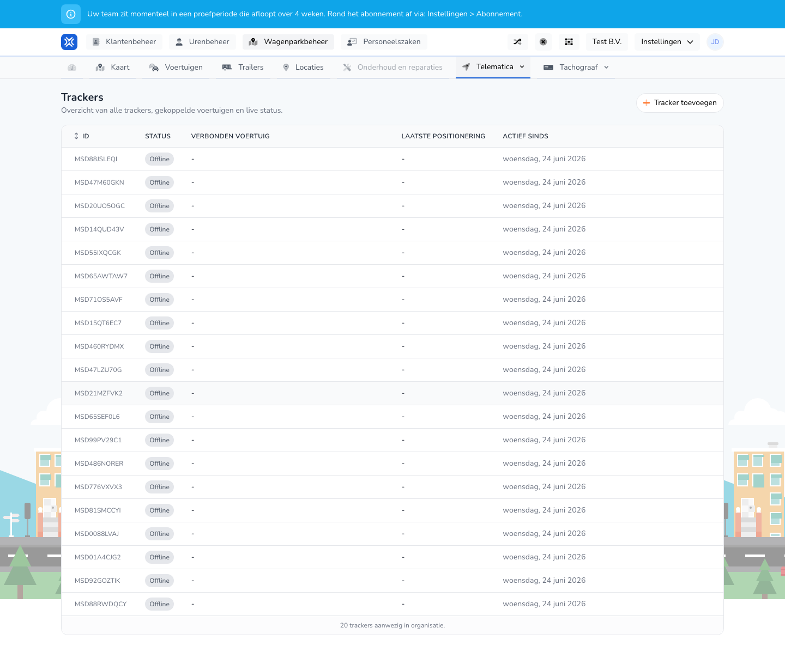

{/* translated-from: nl/management/fleet-management/telematics/trackers/overview.mdx sha256:54b7030ce8c89a4e455e01dff1272d4460b484fad4d0f46dfe65eac12c6f3350 */}

## Do czego służy ta strona

Tutaj widać wszystkie lokalizatory, ich status i z jakim pojazdem są powiązane.

## Co można tutaj zrobić

- Przeglądać lokalizatory.
- Dodać lokalizator.
- Sprawdzać informacje o statusie.

## Zrzut ekranu

## Co widać na stronie

- Przycisk **Dodaj lokalizator**.
- Tabelę z identyfikatorem, statusem, połączonym pojazdem, ostatnią lokalizacją i datą aktywności od.

## Jak korzystać z tej strony

1. Otworzyć **Lokalizatory**.
2. Sprawdzić status lokalizatorów.
3. Użyć **Dodaj lokalizator**, jeśli nowego lokalizatora jeszcze brakuje.

## Co dzieje się potem

- Wiadomo, które lokalizatory są aktywne i w którym pojeździe są zamontowane.

## Warto wiedzieć

- Szczególną uwagę należy zwrócić na statusy offline i brakujące powiązania z pojazdami.
- Ten przegląd pozwala szybko rozpoznawać sygnały techniczne.

## Powiązane strony

- Dodawanie lokalizatora
- Przegląd telematyki

