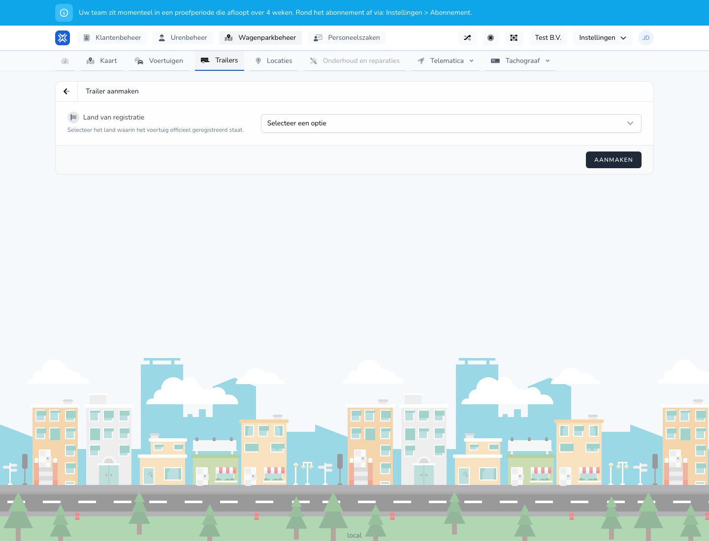

{/* translated-from: nl/management/fleet-management/trailers/create.mdx sha256:a612cf08b6fbf4a106b6ea4b034d6336f02b22ca2b02216d9ac40fff4701f225 */}

## Do czego służy ta strona

Za pomocą tego formularza dodaje się nową naczepę.

## Co można tutaj zrobić

- Zapisać kraj rejestracji.
- Zarejestrować naczepę do dalszego użycia w systemie.

## Zrzut ekranu

## Co widać na stronie

- Ekran **Utwórz naczepę**.
- Wybór kraju rejestracji.
- Przycisk **Utwórz**.

## Jak korzystać z tej strony

1. Otworzyć **Naczepy** i wybrać **Nowy pojazd**.
2. Wybrać właściwy kraj rejestracji.
3. Wypełnić pozostałe dane naczepy, gdy tylko staną się widoczne.
4. Kliknąć **Utwórz**.

## Co dzieje się potem

- Naczepa zostaje dodana do przeglądu.
- Naczepę można następnie wykorzystywać w innych procesach floty.

## Warto wiedzieć

- Należy używać oficjalnych danych rejestracyjnych naczepy.
- Po zapisaniu sprawdzić, czy naczepa pojawiła się w przeglądzie.

## Powiązane strony

- Przegląd naczep
- Edycja naczepy

