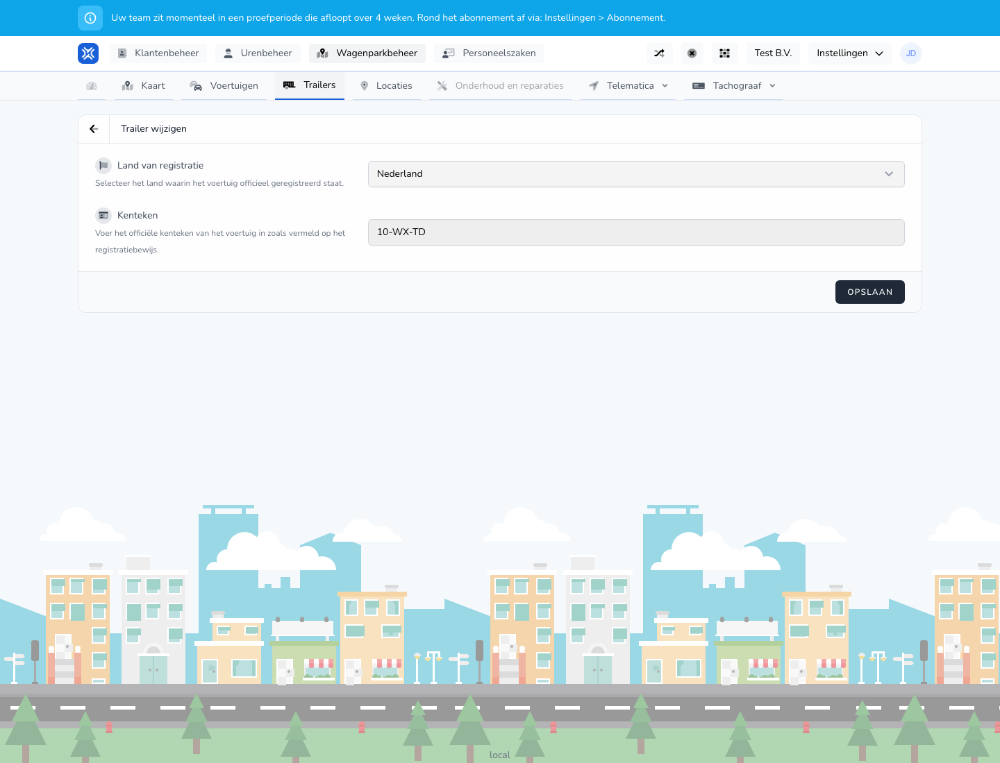

{/* translated-from: nl/management/fleet-management/trailers/edit.mdx sha256:20f39744a5af8330364b9d73f16dc90cd43c2cd7533c4fb9f7f2a961002327ad */}

## Do czego służy ta strona

Na tej stronie zmienia się dane istniejącej naczepy.

## Co można tutaj zrobić

- Zmienić dane rejestracyjne.
- Sprawdzić i zapisać dane naczepy.

## Zrzut ekranu

## Co widać na stronie

- Ekran **Edytuj naczepę**.
- Już wypełnione dane naczepy, takie jak kraj i numer rejestracyjny.
- Formularz podobny do strony dodawania.

## Jak korzystać z tej strony

1. Otworzyć naczepę z przeglądu.
2. Zmienić dane, które się zmieniły.
3. Jeszcze raz sprawdzić wpisane wartości.
4. Zapisać zmianę.

## Co dzieje się potem

- Zmienione informacje o naczepie są od razu używane w przeglądzie i w powiązanych procesach.

## Warto wiedzieć

- Należy zmieniać tylko dane, które naprawdę się zmieniły.
- Po zakończeniu sprawdzić, czy naczepa pozostaje poprawnie rozpoznawalna w przeglądzie.

## Powiązane strony

- Przegląd naczep
- Tworzenie naczepy

