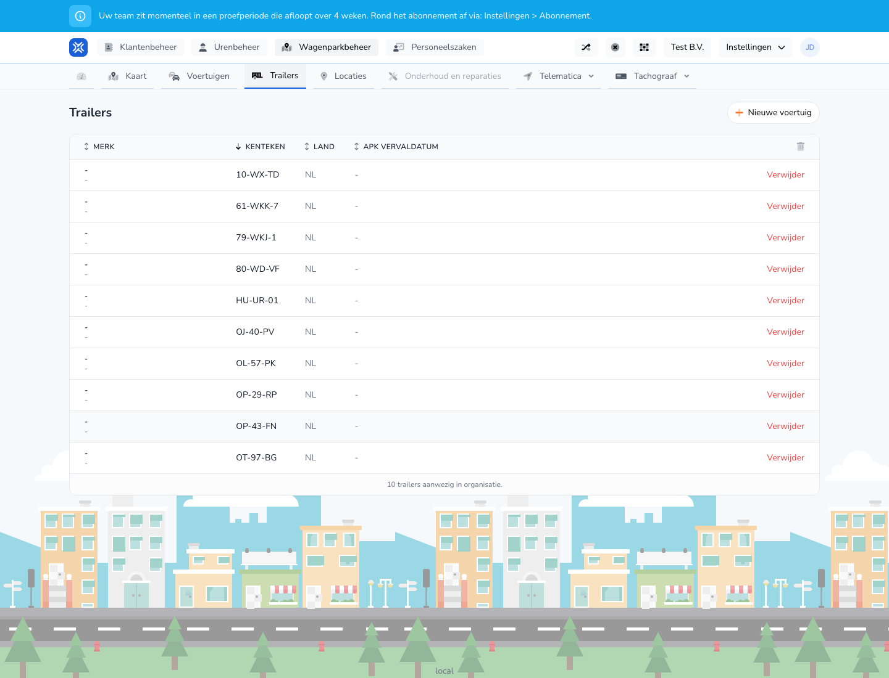

{/* translated-from: nl/management/fleet-management/trailers/overview.mdx sha256:ce82b614f18ebe1bd1aeb1ee77966fa4d51f68900fc4d6bd9b852e88794c8574 */}

## Do czego służy ta strona

Tutaj zarządza się wszystkimi naczepami. Od razu widać, które naczepy są znane i jakie działania są dostępne.

## Co można tutaj zrobić

- Przeglądać naczepy.
- Dodać naczepę.
- Usunąć naczepę.

## Zrzut ekranu

## Co widać na stronie

- Przycisk **Nowy pojazd** do wprowadzenia nowej naczepy.
- Tabelę z numerem rejestracyjnym, krajem i datą ważności przeglądu technicznego.
- Działania przy każdym wierszu naczepy.

## Jak korzystać z tej strony

1. Otworzyć **Naczepy** w zarządzaniu flotą.
2. Znaleźć właściwą naczepę w tabeli.
3. Otworzyć stronę dodawania, aby wprowadzić nową naczepę.
4. Dla dalszych działań użyć akcji dostępnych w wierszu.

## Co dzieje się potem

- Nowe naczepy pojawiają się w przeglądzie.
- Usunięte naczepy znikają z aktywnej listy.

## Warto wiedzieć

- Szczególną uwagę należy zwrócić na numer rejestracyjny i datę ważności.
- W tym przeglądzie szybko widać, czy dane naczep są nadal kompletne.

## Powiązane strony

- Tworzenie naczepy
- Edycja naczepy

