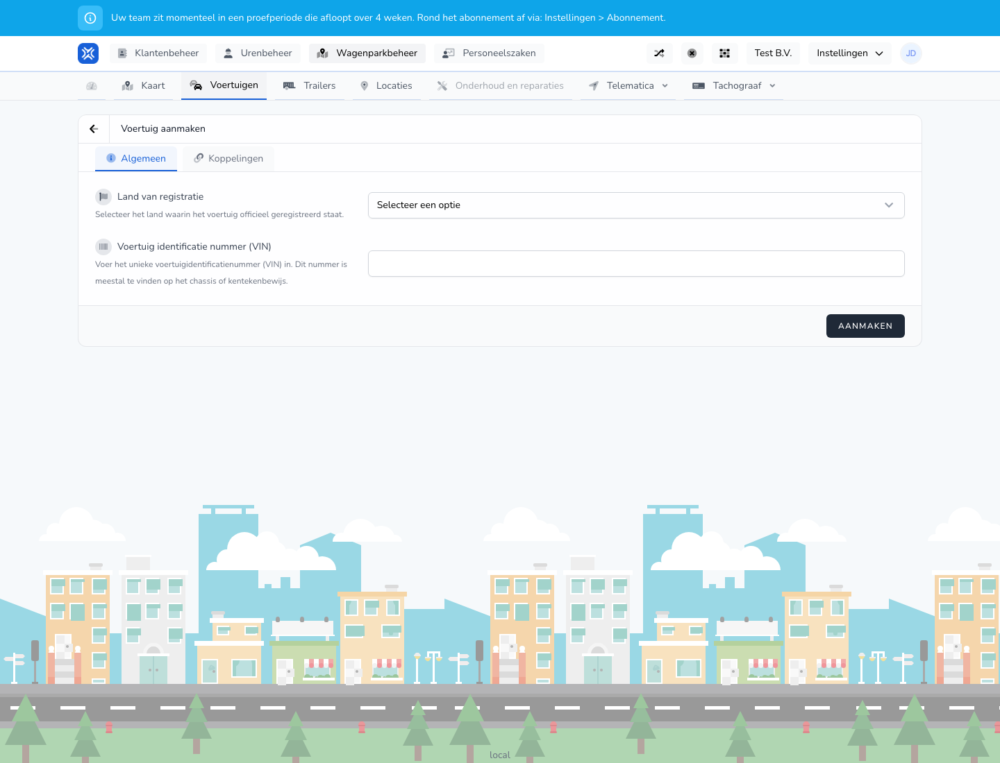

{/* translated-from: nl/management/fleet-management/vehicles/create.mdx sha256:fd477dac8d4b202dc9ad629b8554745b3ad1c863c5acfa78015ef2582f05ad74 */}

## Do czego służy ta strona

Za pomocą tego formularza dodaje się nowy pojazd do floty.

## Co można tutaj zrobić

- Wypełnić ogólne dane pojazdu.
- Zapisać powiązania, takie jak dodatkowe relacje pojazdu.

## Zrzut ekranu

## Co widać na stronie

- Ekran **Utwórz pojazd**.
- Sekcje takie jak **Ogólne** i **Powiązania**.
- Pola m.in. na kraj rejestracji i identyfikację pojazdu.

## Jak korzystać z tej strony

1. Z przeglądu otworzyć **Nowy pojazd**.
2. Najpierw wypełnić ogólne dane pojazdu.
3. Starannie sprawdzić dane rejestracyjne.
4. Następnie przejść przez pozostałe pola lub powiązania.
5. Kliknąć **Utwórz**, gdy wszystko się zgadza.

## Co dzieje się potem

- Pojazd zostaje dodany do floty.
- Pojazd jest następnie widoczny w przeglądzie pojazdów.

## Warto wiedzieć

- Należy używać oficjalnych danych pojazdu z dowodu rejestracyjnego.
- Zapisywać dopiero po wypełnieniu pól obowiązkowych.

## Powiązane strony

- Przegląd pojazdów
- Edycja pojazdu

