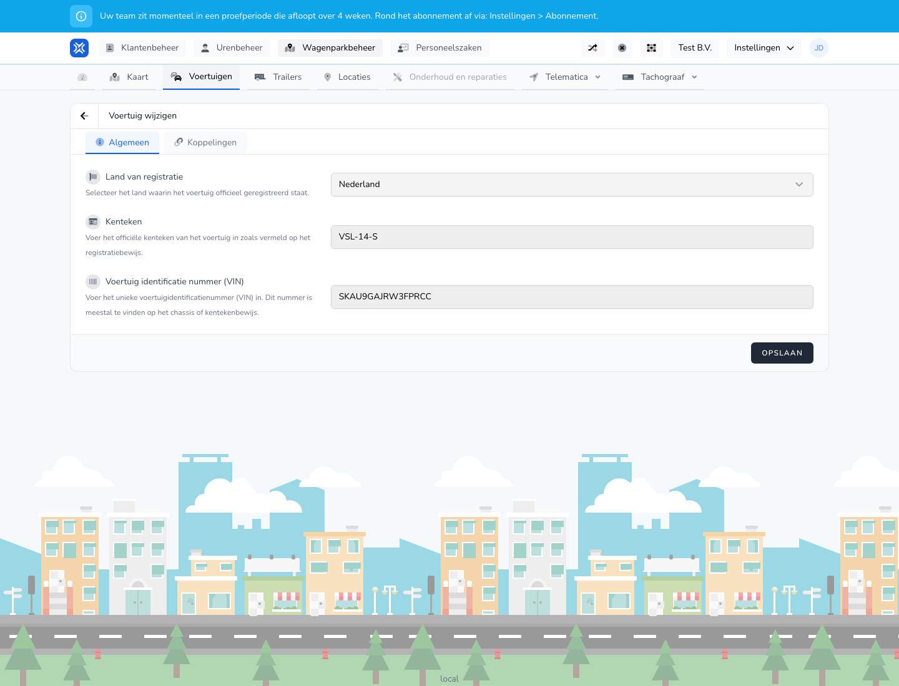

{/* translated-from: nl/management/fleet-management/vehicles/edit.mdx sha256:85343e130739b1c079b1d0d7b1d7c7ba84cb20d6aac85476dff698f5fe7beccf */}

## Do czego służy ta strona

Za pomocą tej strony zmienia się dane istniejącego pojazdu.

## Co można tutaj zrobić

- Zmieniać dane rejestracyjne i dane pojazdu.
- Przejrzeć punkty kontrolne i powiązania.

## Zrzut ekranu

## Co widać na stronie

- Ekran **Edytuj pojazd**.
- Te same główne części co przy tworzeniu, takie jak **Ogólne** i **Powiązania**.
- Już wypełnione dane pojazdu.

## Jak korzystać z tej strony

1. Otworzyć pojazd przez **Edytuj** w przeglądzie.
2. Zmienić tylko te pola, które powinny się zmienić.
3. Po zmianie zawsze sprawdzić numer rejestracyjny, kraj i inne dane identyfikacyjne.
4. Zapisać zmiany.

## Co dzieje się potem

- Zmienione dane stają się widoczne w przeglądzie pojazdów.
- Inne ekrany korzystające z tego pojazdu pokazują potem nowe informacje.

## Warto wiedzieć

- Należy pracować starannie, ponieważ dane pojazdu mogą pojawiać się w wielu miejscach.
- Po zapisaniu sprawdzić, czy zmiana została poprawnie uwzględniona w przeglądzie.

## Powiązane strony

- Przegląd pojazdów
- Tworzenie pojazdu

