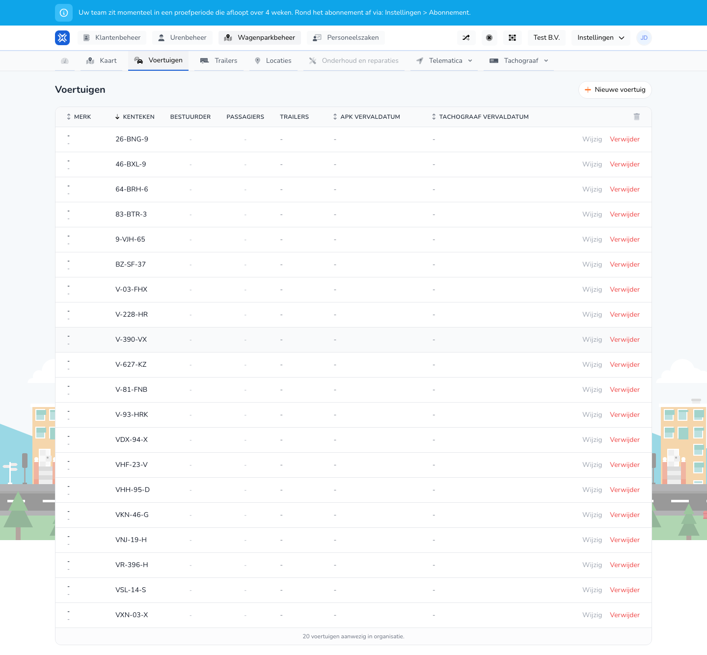

{/* translated-from: nl/management/fleet-management/vehicles/overview.mdx sha256:df0b53871e7802ca7b569d316db71b20ff80ac2dc8585ca85636d24d0f67fc0b */}

## Do czego służy ta strona

Tutaj zarządza się pojazdami organizacji. Dla każdego pojazdu widać najważniejsze dane i dostępne działania.

## Co można tutaj zrobić

- Przeglądać pojazdy.
- Utworzyć nowy pojazd.
- Zmienić lub usunąć istniejący pojazd.

## Zrzut ekranu

## Co widać na stronie

- Przycisk **Nowy pojazd**.
- Tabelę z kolumnami takimi jak marka, numer rejestracyjny, kierowca, pasażerowie i daty ważności.
- Działania takie jak **Edytuj** i **Usuń** w każdym wierszu.

## Jak korzystać z tej strony

1. Otworzyć **Pojazdy** w zarządzaniu flotą.
2. Znaleźć właściwy pojazd w tabeli.
3. Kliknąć **Edytuj**, aby zmienić dane.
4. Kliknąć **Nowy pojazd**, aby wprowadzić dodatkowy pojazd.
5. Użyć **Usuń** tylko wtedy, gdy pojazd nie jest już aktywnie używany.

## Co dzieje się potem

- Po otwarciu **Edytuj** następuje przejście do formularza edycji tego pojazdu.
- Po **Nowy pojazd** otwiera się formularz wprowadzania danych pojazdu.
- Po usunięciu pojazd znika z aktywnego przeglądu.

## Warto wiedzieć

- Przed zapisaniem należy starannie sprawdzić numer rejestracyjny i daty ważności.
- Ten przegląd jest punktem wyjścia dla niemal wszystkich działań związanych z zarządzaniem pojazdami.

## Powiązane strony

- Tworzenie pojazdu
- Edycja pojazdu
- Mapa

