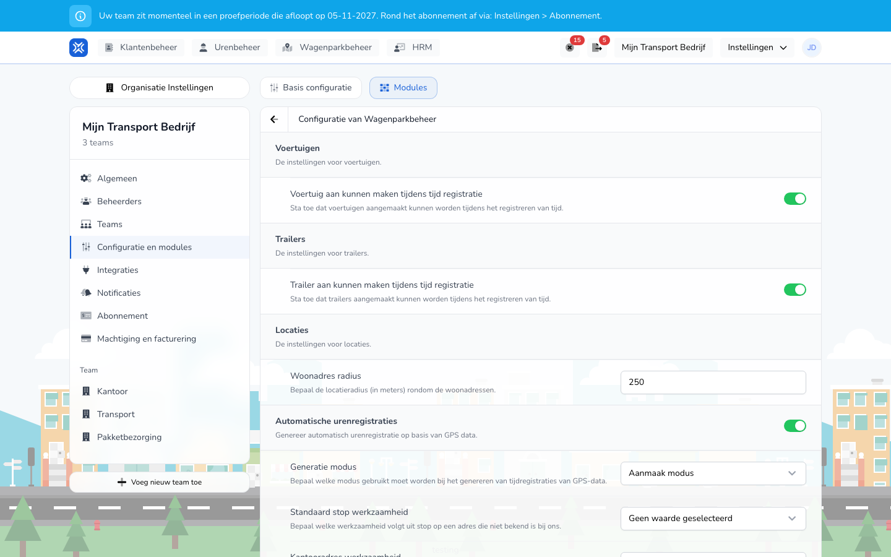

{/* translated-from: nl/management/hour-management/automatic-time-registrations.mdx sha256:8b44d3f0a9616d4758e17dc8431e6c1ec2dadce4e01ed4209ea540241fd87ef9 */}

import { Hint } from '/snippets/hint.jsx';

## Do czego służy ta strona

Dzięki automatycznej rejestracji godzin TransportKlok tworzy rejestracje czasu pracy z przejazdów i postojów przekazywanych przez integrację GPS lub lokalizatory. Pracownicy nie muszą wtedy sami wprowadzać tych godzin.

## Zrzut ekranu

## Kto może z tego korzystać

- Administrator organizacji włącza tę funkcję.
- Organizacja potrzebuje modułów **Zarządzanie flotą** i **Zarządzanie godzinami** oraz pojazdów z lokalizatorem lub integracją GPS. Zob. [Telematyka](/pl/management/fleet-management/telematics/overview).

## Jak korzystać z tej strony

1. Otworzyć **Ustawienia** → **Ustawienia organizacji** → **Konfiguracja i moduły** i wybrać kartę **Moduły**.
2. Przy **Zarządzanie flotą** kliknąć **Ustawienia**.
3. Włączyć **Automatyczne rejestracje czasu pracy**.
4. Wybrać **Tryb generowania** oraz czynności dla każdego rodzaju adresu.
5. Kliknąć **Zapisz**.

## Pola

| Pole | Co należy wybrać |
|------|-------------|
| **Tryb generowania** | **Tryb tworzenia**: TransportKlok tworzy nowe rejestracje czasu pracy z danych GPS. **Tryb zastępowania**: TransportKlok nie tworzy nowych rejestracji, lecz w istniejących rejestracjach uzupełnia czynność **Automatycznie (segment GPS)** o przejazdy i postoje. Domyślnie włączony jest **Tryb tworzenia**. |
| **Domyślna czynność postoju** | Czynność dla postoju pod adresem, którego TransportKlok nie zna. Domyślnie pusta: taki postój nie otrzymuje wtedy czynności. |
| **Czynność pod adresem biura** | Czynność dla postoju pod adresem biura. Domyślnie **Baza**. |
| **Czynność pod adresem zamieszkania** | Czynność dla postoju pod adresem zamieszkania. Domyślnie **Baza**. |
| **Czynność pod adresem klienta** | Czynność dla postoju pod adresem klienta. Domyślnie **Załadunek i rozładunek (zewnętrzny)**. |
| **Długość postoju (minuty)** | Jak długo musi trwać postój, aby zakończyć poprzedzający go przejazd. Domyślnie 240 minut. |
| **Minimalny czas aktywności (sekundy)** | Jak długo musi trwać aktywność, aby stać się wierszem w rejestracji. Domyślnie 60 sekund. |
| **Automatyczne rejestracje zaczynają się od** | Data, od której TransportKlok tworzy rejestracje. Puste: bez stałej daty rozpoczęcia. |
| **Brak stałej daty rozpoczęcia** | Włączone: pracownik nie ma stałej daty rozpoczęcia, niezależnie od daty organizacji. |
| **Nieodpłatne dojazdy do pracy** | Włączone: przejazdy między domem a biurem są księgowane na nieodpłatną czynność dojazdu do pracy. |

To, jakim rodzajem adresu jest postój, wynika z [lokalizacji](/pl/management/fleet-management/locations/overview).

## Co dzieje się potem

- Z przejazdów i postojów pracownika TransportKlok tworzy rejestrację czasu pracy, w której przejazdy i postoje są czynnościami.
- Rejestracje znajdują się w [Rejestracja czasu pracy](/pl/management/hour-management/time-registrations/overview) i w aplikacji pracownika, jak każda inna rejestracja. Zatwierdza się je w taki sam sposób.
- Rejestracji, która została zatwierdzona, którą ktoś zmienił lub która wchodzi w przetworzony okres płacowy, TransportKlok już nie zmienia.

TransportKlok działa w dwóch wersjach automatycznej rejestracji godzin. <Hint kind="grey">To, której wersji używa organizacja, ustawia dla niej TransportKlok. Powyższe ustawienia są takie same dla obu wersji.</Hint>

| Wersja | Jak działa |
|--------|---------------|
| Wersja 1 | TransportKlok tworzy rejestracje jednorazowo z przejazdów i postojów. Jeśli przejazd nakłada się na istniejącą rejestrację, pomija ten przejazd. |
| Wersja 2 | TransportKlok aktualizuje rejestracje, gdy tylko napłyną nowe dane GPS, i nie rusza zatwierdzonych ani zmienionych rejestracji. |

## Ograniczenia

- Automatyczna rejestracja godzin działa dla organizacji z dokładnie jednym zespołem. Jeśli organizacja ma więcej zespołów, przy włączaniu pojawia się komunikat „Automatyczna rejestracja godzin wymaga organizacji z dokładnie jednym zespołem".
- Pracownik musi być w TransportKlok powiązany z pojazdem i z danymi GPS. Bez tego powiązania rejestracje nie powstają.
- Jeśli rejestracja nie pasuje, na przykład dlatego, że nakłada się na istniejącą rejestrację lub wychodzi poza umowę, TransportKlok nie tworzy tej rejestracji. <Hint kind="yellow">Wtedy należy samodzielnie sprawdzić rejestracje z tego dnia w Rejestracja czasu pracy.</Hint>
