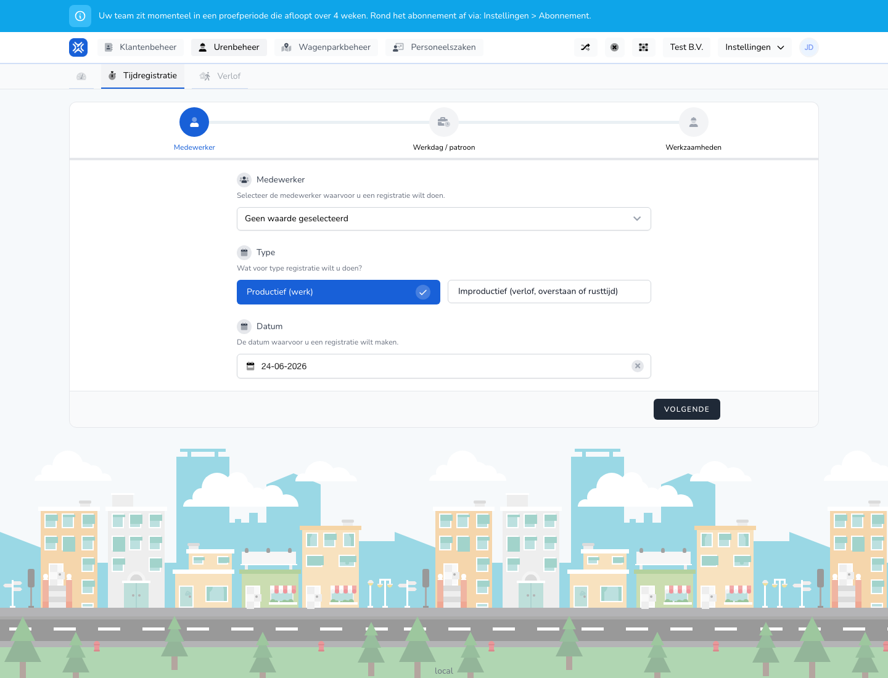

{/* translated-from: nl/management/hour-management/time-registrations/create.mdx sha256:22963265def98d97d89af7272ddb319f82557f14c4a3f75829803939da50db77 */}

## Do czego służy ta strona

Za pomocą tej wieloetapowej strony wprowadza się nową rejestrację czasu pracy dla pracownika.

## Co można tutaj zrobić

- Wybrać pracownika.
- Wybrać typ rejestracji.
- Wpisać datę i dalsze dane rejestracji.

## Zrzut ekranu

## Co widać na stronie

- Kroki takie jak **Pracownik**, **Dzień pracy / wzorzec** i **Czynności**.
- Pola na typ, datę i dalsze dane.

## Jak korzystać z tej strony

1. Wybrać pracownika, dla którego tworzona jest rejestracja.
2. Wybrać właściwy typ rejestracji.
3. Wpisać datę.
4. Wykonywać kolejne kroki jeden po drugim.
5. Zapisać rejestrację, gdy wszystkie kroki są kompletne.

## Co dzieje się potem

- Nowa rejestracja zostaje dodana do przeglądu godzin.
- Później można ją ponownie otworzyć w celu sprawdzenia lub zmiany.

## Warto wiedzieć

- Należy pracować spokojnie, krok po kroku, aby uniknąć błędów.
- Typ rejestracji trzeba wybrać starannie, ponieważ od niego zależy, jakie kolejne kroki będą widoczne.

## Powiązane strony

- Przegląd rejestracji czasu pracy

